# Звіт з лабораторної роботи № 4

- **Тема:** Розгалужені алгоритми
- **Виконав:** Ракша Вадим, група КН-925А
- **Варіант:** 17 (система 1 - Двоканальний температурний контролер; задача 1 — Голосування трьох датчиків)
- **Репозиторій:** https://github.com/Nevalik/raksha-khpi-oop-java-1
- **Гілка:** `lab04`
- **Pull Request:** https://github.com/Nevalik/raksha-khpi-oop-java-1/pull/4

## Мета

Спроєктувати та реалізувати розгалужений алгоритм Java за формальною специфікацією: таблицею рішень, інтервалами, блок-схемою та граничними тестами.

## Варіант (опис завдання)

**Основний варіант (система 1, Двоканальний температурний контролер).** Два незалежні канали вимірюють температуру. Межі й пороги - ті самі, що в розібраному прикладі методички: технічний діапазон [-50, 150], пороги 20, 80, 110 (cold / normal / warning / shutdown). Некоректність хоча б одного каналу дає `invalid`; інакше спільний результат обирається за пріоритетом `shutdown > warning > cold > normal`.

**Алгоритмічна задача 1 (Голосування трьох датчиків).** Три незалежні датчики вимірюють одну температуру, допустимий діапазон [-50, 150]. За трьома коректними показами результат - медіана; при одному некоректному показі результат - середнє двох інших зі статусом `degraded`; при двох або трьох некоректних - статус `failed`.

## Аналіз задачі

### Вхідні дані, межі та категорії

| Категорія | Умова | Пріоритет | Результат |
|---|---|---|---|
| Некоректні дані | T1 або T2 не числові чи поза [-50,150] | 1 | invalid |
| Shutdown | будь-який канал ≥ 110 | 2 | shutdown |
| Warning | жоден не shutdown, будь-який канал у [80,110) | 3 | warning |
| Cold | жоден не shutdown/warning, будь-який канал у [-50,20) | 4 | cold |
| Normal | решта (обидва канали в [20,80)) | 5 | normal |

### Таблиця рішень

| Умова або дія | R1 | R2 | R3 | R4 | R5 |
|---|---|---|---|---|---|
| Дані T1, T2 числово коректні | ні | так | так | так | так |
| Хоча б один канал ≥ 110 | - | так | ні | ні | ні |
| Хоча б один канал у [80,110), жоден ≥110 | - | - | так | ні | ні |
| Хоча б один канал у [-50,20), жоден ≥80 | - | - | - | так | ні |
| **Категорія** | invalid | shutdown | warning | cold | normal |

### Блок-схема

```
початок
  │
  ▼
T1 і T2 числово коректні? ──ні──▶ invalid
  │так
  ▼
будь-який канал ≥110? ──так──▶ shutdown
  │ні
  ▼
будь-який канал у [80,110)? ──так──▶ warning
  │ні
  ▼
будь-який канал у [-50,20)? ──так──▶ cold
  │ні
  ▼
normal
```


### Граничні набори даних

| № | T1 | T2 | Стан1 | Стан2 | Очікувано | Фактично | Пояснення |
|---|---|---|---|---|---|---|---|
| 1 | NaN | 50 | invalid | normal | invalid | invalid | Один канал некоректний |
| 2 | -50.0 | -50.0 | cold | cold | cold | cold | Нижня технічна межа включена |
| 3 | 19.9 | 20.0 | cold | normal | cold | cold | Пріоритет cold над normal |
| 4 | 79.9 | 80.0 | normal | warning | warning | warning | Пріоритет warning над normal |
| 5 | 109.9 | 110.0 | warning | shutdown | shutdown | shutdown | Найвищий пріоритет |
| 6 | 150.0 | 150.0 | shutdown | shutdown | shutdown | shutdown | Верхня технічна межа включена |
| 7 | 150.1 | 0 | invalid | cold | invalid | invalid | Праворуч від верхньої межі |

Усі сім наборів виконано фактичним запуском; фактичні результати збіглися з очікуваними.

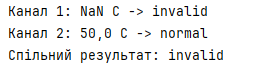

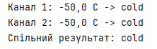

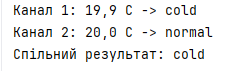

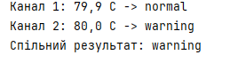

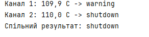

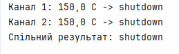

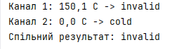


## Аналіз алгоритмічної задачі 1 (SensorVoting)

Вихідний код: [`SensorVoting.java`](../../src/main/java/ua/khpi/oop1/lab04/SensorVoting.java).

### Правило валідності показу

`isValid(t) = Double.isFinite(t) && t >= -50.0 && t <= 150.0`

### Таблиця рішень

| Умова або дія | R1 | R2 | R3 |
|---|---|---|---|
| validCount = 3 | так | ні | ні |
| validCount = 2 | ні | так | ні |
| validCount ≤ 1 | ні | ні | так |
| **Результат** | медіана, `voted` | середнє двох коректних, `degraded` | `failed` |

### Алгоритм

1. Обчислити `v1, v2, v3 = isValid(s1), isValid(s2), isValid(s3)`.
2. `validCount = v1 + v2 + v3` (кількість коректних показів).
3. Якщо `validCount == 3`: `result = median3(s1, s2, s3)`, статус `voted`.
4. Інакше, якщо `validCount == 2`: знайти некоректний показ (`!v1`, потім `!v2`, інакше `!v3`), `result` = середнє двох інших, статус `degraded`.
5. Інакше: статус `failed`, результату немає.

### Блок-схема

```
початок
  │
  ▼
v1, v2, v3 = isValid(s1), isValid(s2), isValid(s3)
validCount = v1 + v2 + v3
  │
  ▼
validCount == 3? ──так──▶ median3 → voted
  │ні
  ▼
validCount == 2? ──так──▶ середнє двох коректних → degraded
  │ні
  ▼
failed
```

### Медіана без сортування

`median3(a, b, c) = a + b + c - max(a, b, c) - min(a, b, c)`.

Максимум і мінімум знаходяться вкладеними `Math.max` / `Math.min` (по два порівняння кожен). Після віднімання найбільшого й найменшого лишається середнє за величиною значення, тому результат не залежить від порядку аргументів.

## Структура класів

| Шлях | Призначення |
|---|---|
| `src/main/java/ua/khpi/oop1/lab04/DecisionController.java` | Реалізація основного варіанта (двоканальний контролер) |
| `src/main/java/ua/khpi/oop1/lab04/SensorVoting.java` | Реалізація алгоритмічної задачі 1 (голосування трьох датчиків) |
| `docs/lab04/report.md` | Цей звіт |
| `docs/lab04/assets`    | Скріншоти запуску |


## Алгоритми та опис програми

### Порядок умов

`DecisionController`: кожен канал класифікується окремо ланцюжком `if-else if` (invalid → cold → normal → warning → shutdown, за зростанням порога). Спільний результат обирається порівнянням пріоритетів (менше число = вищий пріоритет), а не прямим порівнянням значень станів.

`SensorVoting`: спочатку рахується кількість валідних датчиків (`validCount`), потім за її значенням (3 / 2 / ≤1) вибирається одна з трьох гілок: медіана, середнє двох, або відмова.

### Використання if і switch

`if-else if` - для класифікації каналу за інтервалами (неперервна шкала). `switch` - лише для дискретного ключа: перетворення рядка стану на числовий пріоритет (`priority(String state)`).

### Компіляція і запуск

```powershell
javac -d out src\main\java\ua\khpi\oop1\lab04\DecisionController.java src\main\java\ua\khpi\oop1\lab04\SensorVoting.java
java -cp out ua.khpi.oop1.lab04.DecisionController
java -cp out ua.khpi.oop1.lab04.SensorVoting
```

## Тестування і визначення набору даних

### Результати всіх гілок

**DecisionController** (t1=88.8, t2=58.3):
```
Канал 1: 88.8 C -> warning
Канал 2: 58.3 C -> normal
Спiльний результат: warning
```
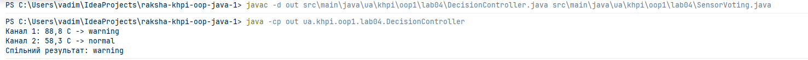

**SensorVoting** (15 тестових наборів, порядок збігається з порядком викликів у `main`):

| № | s1 | s2 | s3 | Очікувано | Вивід програми |
|---|---|---|---|---|---|
| 1 | NaN | NaN | NaN | failed | `status: failed` |
| 2 | 20 | NaN | 24 | 22.00, degraded | `result=22.00, status: degraded` |
| 3 | 20 | 24 | NaN | 22.00, degraded | `result=22.00, status: degraded` |
| 4 | 150.1 | 20 | 30 | 25.00, degraded | `result=25.00, status: degraded` |
| 5 | Infinity | 20 | 30 | 25.00, degraded | `result=25.00, status: degraded` |
| 6 | 20 | 23 | 21 | 21.00, voted | `result=21.00, status: voted` |
| 7 | 23 | 20 | 21 | 21.00, voted | `result=21.00, status: voted` |
| 8 | 21 | 20 | 23 | 21.00, voted | `result=21.00, status: voted` |
| 9 | NaN | 20 | 24 | 22.00, degraded | `result=22.00, status: degraded` |
| 10 | NaN | NaN | 20 | failed | `status: failed` |
| 11 | 200 | NaN | 20 | failed | `status: failed` |
| 12 | -50.0 | -50.0 | -50.0 | -50.00, voted | `result=-50.00, status: voted` |
| 13 | 150.0 | 150.0 | 150.0 | 150.00, voted | `result=150.00, status: voted` |
| 14 | -50.1 | 20 | 30 | 25.00, degraded | `result=25.00, status: degraded` |
| 15 | 34 | 17 | NaN | 25.50, degraded | `result=25.50, status: degraded` |

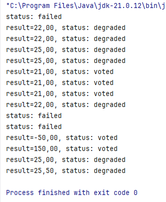

### Проміжне трасування SensorVoting (s1=34.0, s2=17.0, s3=NaN)

| Крок | Значення |
|---|---|
| `isValid(s1)` | true (34.0 у [-50, 150]) |
| `isValid(s2)` | true (17.0 у [-50, 150]) |
| `isValid(s3)` | false (`isFinite(NaN)` = false) |
| `validCount` | 2 |
| Вибір гілки | `validCount == 3`? ні; `validCount == 2`? так |
| Який показ некоректний | `!v1` = false, `!v2` = false, отже гілка `else` → `(s1 + s2) / 2.0` |
| `result` | (34.0 + 17.0) / 2.0 = 25.5 |
| `status` | degraded |

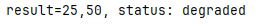

### Ручне тестування умов і переходів

| Перевірка | Очікуваний результат | Фактичний результат | Пояснення |
|---|---|---|---|
| Межа (T=20.0 замість 19.9) | normal замість cold | normal | `<` виключає межу з нижньої категорії - межа належить наступному інтервалу |
| Порядок порогів (`t < 80.0` перед `t < 20.0`), t=10.0 | cold стає недосяжною | замість `cold` отримано `normal` | вужчу умову треба перевіряти раніше за ширшу |
| Коротке замикання: `text != null && !text.isBlank()`, порядок операндів змінено, text=null | помилка виконання при зміненому порядку | `NullPointerException` при `!text.isBlank() && text != null`; безпечний порядок дав `false` | `&&` не обчислює правий операнд, якщо лівий `false`; перевірка на null має стояти ліворуч |
| Fall-through: у копії `switch` пропущено `break` після `case "shutdown"` | виконуються дві гілки | виконано `case shutdown` і `case warning`, результат 1 замість 0 | без `break` виконання проходить у наступну гілку; стрілкова форма цього не допускає |

#### Коротке замикання

Експеримент виконано в окремому тестовому запуску:

```
безпечний порядок: false
змінений порядок: java.lang.NullPointerException
```

У безпечному порядку `text != null` дає `false`, тому `!text.isBlank()` не обчислюється. Після зміни порядку `isBlank()` викликається на `null`. Безпечну форму повернуто.

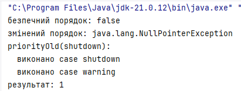  

#### Fall-through

У копії `switch` пропущено `break` після `case "shutdown"`:

```
priorityOld(shutdown):
  виконано case shutdown
  виконано case warning
результат: 1
```

Виконались дві гілки, результат 1 замість 0. Стрілкова форма в `priority(String state)` повертає 0, бо переходу в наступну гілку не відбувається. Експериментальний код видалено.

### Налагодження

Breakpoint встановлено перед першим `if` у `classifyChannel`. Для типового набору (t1=88.8) Step Over показав послідовність: перевірка `isFinite` → `t<20.0` (false) → `t<80.0` (false) → `t<110.0` (true) → `return "warning"`. Для граничного значення t=110.0 трасування показало: усі три `<`-перевірки дали false, виконано `else { return "shutdown"; }` - підтверджує, що межа 110 включена в shutdown, а не в warning.

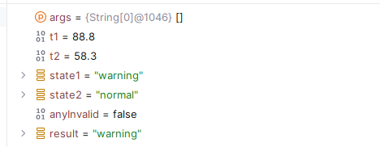

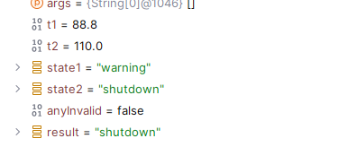

## Висновки

Реалізовано двоканальний температурний контролер (основний варіант) та алгоритм голосування трьох датчиків із медіаною без сортування (задача 1). Усі 7 граничних наборів основного завдання виконано фактичним запуском, фактичні результати збіглися з очікуваними. Для SensorVoting складено таблицю рішень, алгоритм і проміжне трасування набору `34.0, 17.0, NaN` (`validCount = 2`, результат 25.5, `degraded`); виконано тестові набори, зокрема три некоректні покази, некоректний показ на кожній позиції, значення 150.1 та Infinity. Ручні перевірки виконано реально: зміна порядку порогів зробила гілку `cold` недосяжною (для t=10.0 отримано `normal`); перестановка операндів у `text != null && !text.isBlank()` призвела до `NullPointerException`, що підтверджує коротке замикання `&&`; пропуск `break` у традиційному `switch` дав виконання двох гілок і результат 1 замість 0, а стрілкова форма цього виключає.