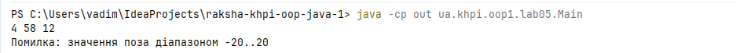
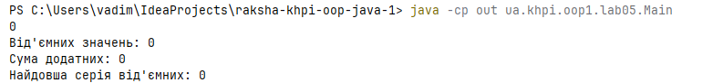
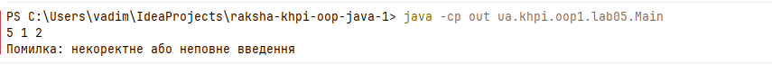
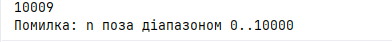
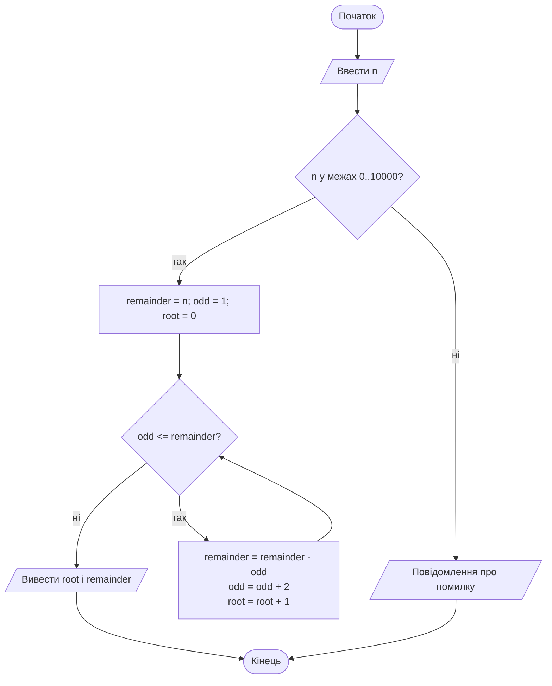
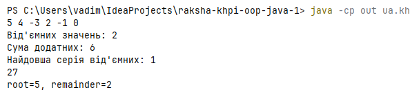
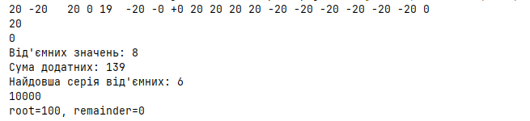
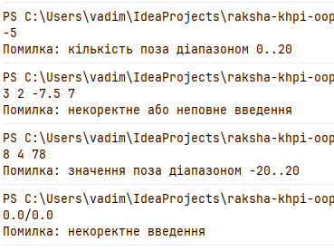
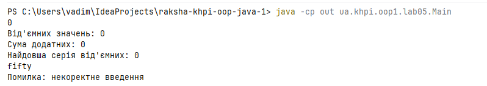
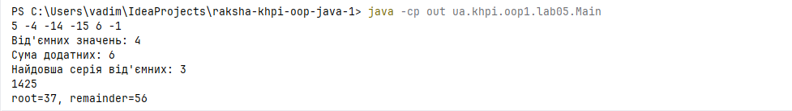

# Звіт з лабораторної роботи № 5

**Тема:** Циклічна обробка послідовностей
**Дисципліна:** Об'єктно-орієнтоване програмування (Java). Частина 1
**Виконав:** Ракша Вадим КН-925а
**Варіант:** 1 , завдання A 
**Гілка:** `lab05`
**Pull Request:** 

---

## Налаштування середовища

| Параметр | Значення |
|----------|----------|
| Операційна система | `Windows 11` |
| JDK | 21 (`"21.0.12" 2026-07-21 LTS`) |
| Git | `2.53.0.windows.1` |
| IDE | IntelliJ IDEA `2026.2.3` |
| Репозиторій | `raksha-khpi-oop-java-1` |
| Пакет | `ua.khpi.oop1.lab05` |
| Вихідний код | [`Main.java`](../../src/main/java/ua/khpi/oop1/lab05/Main.java) |


Maven і Gradle не використовуються. Код компілюється вручну до каталогу `out/`, який додано до `.gitignore`

```
javac -encoding UTF-8 -d out src/main/java/ua/khpi/oop1/lab05/Main.java
java -cp out ua.khpi.oop1.lab05.Main
```

Структура репозиторію:

```
raksha-khpi-oop-java-1
├── README.md
├── .gitignore
├── docs/lab05/REPORT.md
├── docs/lab05/assets/
└── src/main/java/ua/khpi/oop1/lab05/Main.java
```

## Мета

Дослідити циклічну обробку послідовностей: спроєктувати стан циклу, визначити його кроки й умову завершення, простежити зміну змінних і перевірити результат на звичайних та граничних даних.

---

## Обов'язковий рівень — варіант 1

### Умова

**Вхідні дані:** кількість `count` від 0 до 20, далі стільки цілих значень від −20 до 20.

При порушенні умови програма зупиняється та виводить повідомлення про помилку.




**Потрібно:**
1. порахувати від'ємні значення;
2. знайти суму додатних значень (нулі не враховувати);
3. визначити довжину найдовшої серії послідовних від'ємних значень (якщо їх немає, довжина дорівнює 0).

### Аналіз задачі

**Контракт**

| Елемент | Опис |
|---------|------|
| Вхід | `count` ∈ [0; 20], далі `count` цілих `value` ∈ [−20; 20] |
| Вихід | `negativeCount`, `positiveSum`, `longestNegativeRun` |
| Порожня послідовність | `count = 0` → 0 / 0 / 0 |
| `count` поза [0; 20] | помилка діапазону |
| `value` поза [−20; 20] | помилка діапазону |
| Нечисловий токен | помилка введення |
| Дані закінчились раніше, ніж заявлено | програма очікує введення; після завершення потоку виводиться помилка введення(Див. тест  №11) |

**Особливості:**
- Нуль не є від'ємним, тому він обриває серію від'ємних значень і не додається до суми.
- Додатне значення також обриває серію.
- Максимальна сума додатних: 20 · 20 = 400, тож `int` теж вистачило б. Тип `long` вибрано для надійності за вимогою методички добирати тип, що вміщує всі проміжні значення.
- Перед кожним читанням викликається `hasNextInt()`, тому некоректне введення не призводить до винятку `InputMismatchException` чи `NoSuchElementException`.


### Обґрунтування циклу

| Елемент | Рішення |
|---------|---------|
| Вид циклу | `for`: кількість ітерацій відома одразу після прочитаного `count` |
| Початковий стан | `i = 0`, `negativeCount = 0`, `positiveSum = 0`, `currentRun = 0`, `longestNegativeRun = 0` |
| Крок оновлення | `i++`; на кожній ітерації читається і обробляється рівно одне значення |
| Умова продовження | `i < count` (строга нерівність, інакше була б зайва ітерація) |
| Завершення | `i` зростає на 1, межа `count ≤ 20` скінченна, отже, ітерацій не більше 20 |
| Порожній випадок | для `count = 0` тіло не виконується жодного разу |

### Алгоритм (псевдокод)

```
negativeCount ← 0; positiveSum ← 0; currentRun ← 0; longest ← 0
прочитати count; якщо не число → помилка введення
якщо count < 0 або count > 20 → помилка діапазону
для i від 0 до count − 1:
    прочитати value; якщо не число → помилка введення
    якщо value < −20 або value > 20 → помилка діапазону
    якщо value < 0:
        negativeCount ← negativeCount + 1
        currentRun ← currentRun + 1
        якщо currentRun > longest: longest ← currentRun
    інакше:
        currentRun ← 0
        якщо value > 0: positiveSum ← positiveSum + value
```

Ключовий фрагмент реалізації:

```text
for (int i = 0; i < count; i++) {
    if (!in.hasNextInt()) {
        System.out.println("Помилка: некоректне або неповне введення");
        return false;
    }
    int value = in.nextInt();
    if (value < -20 || value > 20) {
        System.out.println("Помилка: значення поза діапазоном -20..20");
        return false;
    }
    accept(value);
}
```

Обробку одного значення виконує окремий метод, який нічого не читає й не друкує:

```java
static void accept(int value) {
    if (value < 0) {
        negativeCount++;
        currentNegativeRun++;
        if (currentNegativeRun > longestNegativeRun) {
            longestNegativeRun = currentNegativeRun;
        }
    } else {
        currentNegativeRun = 0;
        if (value > 0) {
            positiveSum += value;
        }
    }
}
```

### Трасування

Вхід: `8` і далі `-3 5 -1 -2 0 -4 7 -6` (усі 8 ітерацій).

| i | value | Умова / дія | negativeCount | currentNegativeRun (до → після) | longestNegativeRun | positiveSum |
|---|-------|-------------|---------------|--------------------------|--------------------|-------------|
| 0 | −3 | від'ємне, серія росте | 0 → 1 | 0 → 1 | 0 → 1 | 0 |
| 1 | 5 | додатне, серія обривається, сума росте | 1 | 1 → 0 | 1 | 0 → 5 |
| 2 | −1 | від'ємне | 1 → 2 | 0 → 1 | 1 | 5 |
| 3 | −2 | від'ємне, серія 2 | 2 → 3 | 1 → 2 | 1 → 2 | 5 |
| 4 | 0 | нуль, серія обривається, сума не змінюється | 3 | 2 → 0 | 2 | 5 |
| 5 | −4 | від'ємне | 3 → 4 | 0 → 1 | 2 | 5 |
| 6 | 7 | додатне, серія обривається | 4 | 1 → 0 | 2 | 5 → 12 |
| 7 | −6 | від'ємне | 4 → 5 | 0 → 1 | 2 | 12 |

Після `i = 8` умова `i < count` хибна, цикл завершується.
**Результат:** `negativeCount = 5`, `positiveSum = 12`, `longestNegativeRun = 2`.

### Протокол перевірки

| № | Вхід | Тип | Очікувано (від'ємних / сума / серія) | Фактично | Статус |
|---|------|-----|--------------------------------------|----------|--------|
| 1 | `0` | мінімальний, порожня послідовність | 0 / 0 / 0 | 0 / 0 / 0 | + |
| 2 | `8 -3 5 -1 -2 0 -4 7 -6` | типовий | 5 / 12 / 2 | 5 / 12 / 2 | + |
| 3 | `3 -1 -2 -3` | усі від'ємні | 3 / 0 / 3 | 3 / 0 / 3 | + |
| 4 | `4 1 2 0 3` | немає від'ємних | 0 / 6 / 0 | 0 / 6 / 0 | + |
| 5 | `3 -20 20 0` | межі діапазону значень | 1 / 20 / 1 | 1 / 20 / 1 | + |
| 6 | `20` і двадцять разів `-20` | максимальна кількість | 20 / 0 / 20 | 20 / 0 / 20 | + |
| 7 | `21` | `count` поза межами | помилка діапазону | помилка діапазону | + |
| 8 | `-1` | `count` від'ємний | помилка діапазону | помилка діапазону | + |
| 9 | `2 5 21` | значення поза межами | помилка діапазону | помилка діапазону | + |
| 10 | `3 1 abc 2` | некоректний токен | помилка введення | помилка введення | + |
| 11 | `5 1 2` | даних менше, ніж заявлено | помилка введення (після завершення потоку) | очікування нових даних ; "Помилка: некоректне або неповне введення" при завершенні потоку | + |
| 12 | порожнє введення | відсутній `count` | помилка введення | помилка введення | + |

Для відсутнього count виводиться "некоректне введення", для обірваного списку значень — "некоректне або неповне введення"

 **Тест №1**



**Тест №11**



**Тест №12**


---

## Поглиблений рівень — A

### Завдання

**Цілий квадратний корінь через непарні числа.** Для цілого `n ∈ [0; 10000]` послідовно віднімати від залишку числа 1, 3, 5, 7, …, доки наступне віднімання не перевищило б залишок. Повернути кількість успішних віднімань як ⌊√n⌋ і невід'ємний залишок

Якщо введене число знаходиться поза діапазоном, то програма зупиняється та виводить повідомлення про помилку.



Варіант 1 непарний, тому за п. 5.3 методички виконується завдання A.

### Аналіз задачі

| Елемент | Опис |
|---------|------|
| Вхід | ціле `n`, 0 ≤ n ≤ 10000 |
| Вихід | `root = ⌊√n⌋` і `remainder = n − root²` |
| Некоректні дані | не число → помилка введення; `n` поза [0; 10000] → помилка діапазону |
| Перевірна властивість | `root² + remainder = n` і `0 ≤ remainder ≤ 2·root` |

### Алгоритми та опис програми

**Ключова ідея.** Сума перших `k` непарних чисел дорівнює `k²`:

1 + 3 + 5 + … + (2k − 1) = k².

Віднімаючи послідовні непарні числа, ми віднімаємо повні квадрати 1, 4, 9, 16, …. Кількість віднімань, які ще вміщуються в `n`, дорівнює ⌊√n⌋, а те, що залишилось, є залишком `n − root²`.

**Псевдокод.**

```
remainder ← n
odd       ← 1
root      ← 0
поки odd ≤ remainder:
    remainder ← remainder − odd
    odd       ← odd + 2
    root      ← root + 1
повернути root, remainder
```

**Блок-схема.**



**Обґрунтування циклу.**

| Елемент | Рішення |
|---------|---------|
| Вид циклу | `while`: кількість повторень наперед невідома, умову можна перевірити до першої дії |
| Початковий стан | `remainder = n`, `odd = 1`, `root = 0` |
| Крок оновлення | `remainder -= odd`, `odd += 2`, `root++` |
| Умова продовження | `odd <= remainder` |
| Порожній випадок | для `n = 0` умова `1 <= 0` хибна, тіло не виконується, результат (0, 0) |
| Скінченність | `odd` зростає на 2 щоразу, а `remainder` не зростає, тому умова зрештою стає хибною; ітерацій не більше 100 |

**Інваріант циклу.** Перед кожною перевіркою умови:
`remainder = n − root²` і `odd = 2·root + 1`.

| Частина | Обґрунтування |
|---------|---------------|
| Ініціалізація | `root = 0`: `remainder = n − 0 = n`, `odd = 2·0 + 1 = 1` |
| Збереження | після кроку `remainder' = n − root² − (2·root + 1) = n − (root + 1)²`, `odd' = 2·(root + 1) + 1` |
| Завершення | умова хибна: `odd > remainder`, тобто `2·root + 1 > n − root²`, звідси `(root + 1)² > n`. Віднімання виконувалось лише за `odd ≤ remainder`, тому `root² ≤ n`. Отже, `root = ⌊√n⌋` і `remainder ≥ 0` |

**Складність.** Час O(√n), пам'ять O(1). `Math.sqrt` не використовується.

**Реалізація** (метод `computeIntegerSqrt` у [`Main.java`](../../src/main/java/ua/khpi/oop1/lab05/Main.java)); межі `0..10000` перевіряє метод `processTaskA` до виклику:

```java
static void computeIntegerSqrt(int n) {
    int remainder = n;
    int odd = 1;
    int root = 0;
    while (odd <= remainder) {
        remainder -= odd;
        odd += 2;
        root++;
    }
    sqrtRoot = root;
    sqrtRemainder = remainder;
}
```

### Трасування (n = 27, усі ітерації)

| Ітерація | odd (до) | Умова `odd <= remainder` | remainder до → після | root до → після | odd після |
|----------|----------|--------------------------|----------------------|-----------------|-----------|
| 1 | 1 | 1 ≤ 27, істина | 27 → 26 | 0 → 1 | 3 |
| 2 | 3 | 3 ≤ 26, істина | 26 → 23 | 1 → 2 | 5 |
| 3 | 5 | 5 ≤ 23, істина | 23 → 18 | 2 → 3 | 7 |
| 4 | 7 | 7 ≤ 18, істина | 18 → 11 | 3 → 4 | 9 |
| 5 | 9 | 9 ≤ 11, істина | 11 → 2 | 4 → 5 | 11 |
| — | 11 | 11 ≤ 2, хибна | завершення | | |

**Результат:** `root = 5`, `remainder = 2`. Перевірка: 5² + 2 = 27.

### Протокол перевірки

| № | Вхід `n` | Тип | Очікувано (root, remainder) | Фактично | Статус |
|---|----------|-----|-----------------------------|----------|--------|
| 1 | 0 | мінімальний (цикл не виконався) | 0, 0 | 0, 0 | + |
| 2 | 27 | типовий (за методичкою) | 5, 2 | 5, 2 | + |
| 3 | 49 | повний квадрат (за методичкою) | 7, 0 | 7, 0 | + |
| 4 | 1 | найменший додатний | 1, 0 | 1, 0 | + |
| 5 | 2 | перед наступним квадратом | 1, 1 | 1, 1 | + |
| 6 | 3 | максимальний залишок для root = 1 | 1, 2 | 1, 2 | + |
| 7 | 4 | повний квадрат | 2, 0 | 2, 0 | + |
| 8 | 9999 | власний граничний: максимальний залишок (2·99 = 198) | 99, 198 | 99, 198 | + |
| 9 | 10000 | верхня межа | 100, 0 | 100, 0 | + |
| 10 | −1 | нижче межі | помилка діапазону | помилка діапазону | + |
| 11 | 10001 | вище межі | помилка діапазону | помилка діапазону | + |
| 12 | `abc` | некоректний токен | помилка введення | помилка введення | + |

Для кожного успішного запуску виконується перевірна властивість `root² + remainder = n` і `remainder ≤ 2·root`.


---

## Структура класів

Обидва завдання реалізовано в одному класі `Main` пакета `ua.khpi.oop1.lab05`, як на рисунку структури репозиторію з методички. Додаткових класів не вводилося.

| Елемент | Призначення |
|---------|-------------|
| `negativeCount`, `positiveSum`, `currentNegativeRun`, `longestNegativeRun` | стан обробки послідовності (варіант 1) |
| `sqrtRoot`, `sqrtRemainder` | результат завдання A |
| `accept(int)` | обробка одного значення послідовності; нічого не читає й не друкує |
| `computeIntegerSqrt(int)` | обчислення завдання A; нічого не читає й не друкує |
| `processVariant1(Scanner)` | введення, перевірка меж і виведення варіанта 1; повертає `false` за некоректних даних |
| `processTaskA(Scanner)` | введення, перевірка меж і виведення завдання A |
| `main(String[])` | викликає `processVariant1`, а якщо дані були коректні — `processTaskA` |

Обчислення (`accept`, `computeIntegerSqrt`) відокремлені від введення й виведення. Результати передаються через статичні поля, бо повернення кількох значень з методу потребувало б масивів або класів, які ще не вивчені.

**Порядок введення.** За один запуск програма читає спочатку дані варіанта 1 (`count` і `count` значень), а потім число `n` для завдання A. Якщо дані варіанта 1 некоректні, виводиться повідомлення про помилку й програма завершується.

---

## Тестування і визначення набору даних

Набори даних охоплюють:

- **мінімальні** випадки: `count = 0`, `n = 0`;


- **типові** випадки: набір із трасування варіанта 1 і `n = 27`;





- **граничні** випадки: значення −20, 20 і 0; 20 елементів; `n = 1, 2, 3, 4`, `n = 9999`, `n = 10000`;





- **некоректні** дані: значення й кількість поза межами, нечислові токени, неповне та порожнє введення.








Приклад сеансу (введення: `5 -4 -14 -15 6 -1`, потім `1425`):




```
5 -4 -14 -15 6 -1
Від'ємних значень: 4
Сума додатних: 11
Найдовша серія від'ємних: 3
1425
root=37, remainder=56
```

---

## Висновки

У лабораторній роботі № 5 досліджено циклічну обробку послідовностей на прикладі варіанта 1 (обов'язковий рівень) і завдання A (поглиблений рівень).

**Обов'язковий рівень, варіант 1.** Програма послідовно читає кількість значень (0..20) і стільки цілих чисел від −20 до 20 без використання масивів і колекцій. Обрано цикл `for`, оскільки кількість ітерацій відома одразу після прочитаного `count`. Стан алгоритму складається з лічильника ітерацій `i`, кількості від'ємних значень `negativeCount`, суми додатних `positiveSum` (тип `long`), довжини поточної серії `currentNegativeRun` і довжини найдовшої серії `longestNegativeRun`. Нуль і додатні значення обривають серію від'ємних, а нуль не додається до суми. Порожня послідовність (`count = 0`) дає результат 0 / 0 / 0, а значення поза діапазоном і некоректні токени мають визначену реакцію: повідомлення про помилку без винятків. Обробка значення (`accept`) відокремлена від введення й виведення (`processVariant1`). Трасування для набору `-3 5 -1 -2 0 -4 7 -6` збігається з очікуваним результатом: 5 від'ємних, сума додатних 12, найдовша серія 2.

**Поглиблений рівень, завдання A.** Цілий квадратний корінь знаходиться відніманням послідовних непарних чисел 1, 3, 5, … на підставі тотожності 1 + 3 + … + (2k − 1) = k². Обрано цикл `while`, бо кількість повторень наперед невідома, а умову `odd <= remainder` можна перевірити до першої дії (для `n = 0` тіло не виконується жодного разу). Інваріант `remainder = n − root²`, `odd = 2·root + 1` зберігається на кожній ітерації, а після завершення він разом із хибною умовою дає `root = ⌊√n⌋` і `0 ≤ remainder ≤ 2·root`. Цикл завершується, бо `odd` зростає на 2, а `remainder` не збільшується; для `n ≤ 10000` ітерацій не більше 100. Алгоритм має складність O(√n) за часом і O(1) за пам'яттю та не використовує `Math.sqrt`. Перевірки для 27 → (5, 2), 49 → (7, 0), 0 → (0, 0) та граничних значень 9999 і 10000 підтвердили правильність реалізації, а некоректні дані (−1, 10001, не число) відхиляються з повідомленням.

**Загальний підсумок.** Вибір виду циклу, початкового стану, кроку оновлення та умови завершення визначався умовою задачі: `for` для відомої кількості кроків і `while` для кроків, кількість яких залежить від стану. Таблиці трасування та протоколи перевірки з очікуваними й фактичними результатами показали, що алгоритми коректні для типових, граничних і некоректних даних. Робота відповідає вимогам методички: код розміщено в пакеті `ua.khpi.oop1.lab05`, він компілюється через `javac` до `out/` і працює однаково в IDE та з командного рядка.

---

