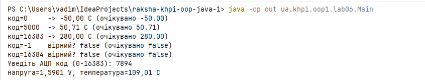
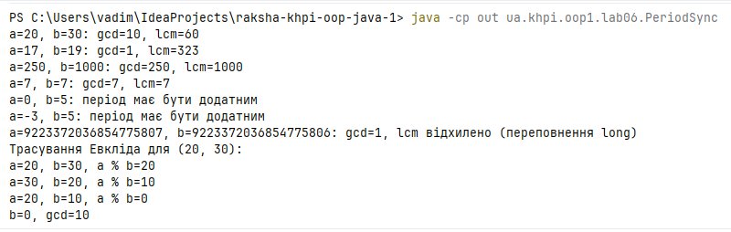

# Звіт з лабораторної роботи № 6

**Тема:** Декомпозиція консольної програми на методи
- **Дисципліна:** Об'єктно-орієнтоване програмування (Java). Частина 1
- **Студент:** Вадим Ракша, група КН-925А, № 17 (варіант 1)
- **Гілка:** `lab06`
- **Pull Request:** https://github.com/Nevalik/raksha-khpi-oop-java-1/pull/7

## Налаштування середовища

- JDK 21, Git, IntelliJ IDEA.
- Репозиторій: `raksha-khpi-oop-java-1`, код у `src/main/java/ua/khpi/oop1/lab06/`, пакет `ua.khpi.oop1.lab06`.
- Складання вручну, результат у `out/`. Клас `PeriodSync` компілюється разом із `Main.java`:

```
javac -encoding UTF-8 -d out src/main/java/ua/khpi/oop1/lab06/Main.java src/main/java/ua/khpi/oop1/lab06/PeriodSync.java
java -cp out ua.khpi.oop1.lab06.Main
java -cp out ua.khpi.oop1.lab06.PeriodSync
```


## Мета

Навчитися ділити консольну програму на методи з чіткими параметрами, результатами й відповідальністю та перевіряти обчислювальні методи окремо від введення і виведення.

## Обов'язковий рівень — варіант 1

**Завдання:** перетворити код АЦП на напругу, а напругу — на температуру. Метод перетворення повертає кінцеву температуру; проміжна напруга показується для перевірки обох кроків.

Код: [`Main.java`](../../src/main/java/ua/khpi/oop1/lab06/Main.java)

## Поглиблений рівень — A

Номер варіанта непарний, тому виконується завдання A «Синхронізація періодичних подій»: знайти найбільший спільний дільник періодів `a` і `b` (мс) та перше спільне спрацювання після нульового моменту (НСК).

Код: [`PeriodSync.java`](../../src/main/java/ua/khpi/oop1/lab06/PeriodSync.java)

## Аналіз задачі

### Варіант 1 (АЦП → напруга → температура)

- АЦП 14-бітний, коди `0-16383`, опорна напруга 3,3 В — за прикладом із розділу 3.15 методичних вказівок;
- лінійне калібрування `T = (U − 0,5) · 100` (°C) — характеристика датчика типу TMP36 (за аналогією з лінійною моделлю `250·U − 25` із розділу 3.16). Коефіцієнти винесено в константи, тому їх можна змінити в одному місці.

**Контракти методів:**

| Метод | Вхід | Результат | Реакція на некоректні дані |
|---|---|---|---|
| `isValidCode(int code)` | код АЦП | `boolean` | — |
| `isValidVoltage(double voltageVolts)` | напруга, В | `boolean` (`true`, якщо скінченна) | — |
| `voltageFromCode(int code)` | код АЦП | напруга, В | `IllegalArgumentException`, якщо код поза `0..16383` |
| `temperatureFromVoltage(double voltage)` | напруга, В | температура, °C | `IllegalArgumentException`, якщо значення не скінченне (NaN, ±∞) |
| `temperatureFromCode(int code)` | код АЦП | температура, °C | делегує двом методам вище, тому поведінка успадкована |

Константи: `MAX_CODE = 16383`, `REFERENCE_VOLTS = 3.3`, `OFFSET_VOLTS = 0.5`, `CELSIUS_PER_VOLT = 100.0`.

Формули:

- U = code · 3.3 / 16383 (В);
- T = (U − 0.5) · 100 (°C).

Діапазон результату: від −50 °C (код 0) до 280 °C (код 16383).

**Стани введення:**

- нечисловий ввід — програма виводить «помилка введення» і завершується;
- код поза `0..16383` — виводиться повідомлення про відмову, обчислення не виконується;
- допустимий код — виводяться напруга й температура.

### Завдання A (НСД / НСК періодів)

- **Вхід:** періоди `a`, `b` типу `long`, у мілісекундах.
- **Обмеження:** `a > 0` і `b > 0`.
- **Результат:** `gcd(a, b)` і `lcm(a, b)` — перше спільне спрацювання після нульового моменту.
- **Некоректні дані:** `gcd` і `lcm` викидають `IllegalArgumentException` для недодатного періоду. Метод `printCheck` не викликає їх для такого вводу: він спершу перевіряє умову через `isValidPeriods` і друкує повідомлення.
- **Переповнення:** `lcm` викидає `ArithmeticException`, якщо НСК виходить за діапазон `long`; перевірка `isLcmInRange` виконується до множення. `printCheck` так само перевіряє `isLcmInRange` заздалегідь і друкує повідомлення замість виклику `lcm`.

## Структура класів

**`Main`** (обов'язковий рівень)

- `isValidCode` — перевірка допустимості коду;
- `isValidVoltage` — перевірка, що напруга скінченна;
- `voltageFromCode`, `temperatureFromVoltage`, `temperatureFromCode` — обчислення (без введення/виведення);
- `main` — контрольні виклики числового ядра, введення коду через `Scanner` і друк результату.

**`PeriodSync`** (поглиблений рівень)

- `isValidPeriods` — перевірка додатності періодів;
- `gcd` — алгоритм Евкліда;
- `isLcmInRange`, `lcm` — перевірка діапазону та обчислення НСК;
- `printCheck`, `printGcdTrace` — виведення (побічний ефект);
- `main` — набір перевірок.

Граф викликів іде зверху вниз без циклів: `main` → `temperatureFromCode` → `voltageFromCode`, `temperatureFromVoltage`; `main` (`PeriodSync`) → `printCheck` → `gcd`, `lcm` → `isLcmInRange` → `gcd`.

Обчислювальні методи не читають і не друкують дані: введення й друк винесені в `main`, `printCheck`, `printGcdTrace`.

## Алгоритми та опис програми

### Варіант 1

1. `main` викликає числове ядро прямими викликами (без введення) для кодів 0, 5000, 16383 і перевіряє `isValidCode` для −1 та 16384.
2. `main` читає код АЦП через `Scanner`.
3. `isValidCode` перевіряє діапазон `0..16383`.
4. `voltageFromCode` обчислює напругу. Код спочатку перетворюється на `double`, щоб ділення не було цілочисельним (інакше `code / MAX_CODE` майже завжди дорівнювало б 0).
5. `temperatureFromVoltage` обчислює температуру.
6. `main` друкує напругу і температуру.

### Завдання A

**Алгоритм Евкліда (псевдокод):**

```
gcd(a, b):
    якщо a <= 0 або b <= 0: відхилити
    поки b > 0:
        (a, b) = (b, a mod b)
    повернути a
```

Ключова ідея: gcd(a, b) = gcd(b, a mod b), а при b = 0 відповідь дорівнює a. Залишок щоразу строго менший за дільник, тому цикл скінченний.

**НСК:** `lcm(a, b) = a / gcd(a, b) * b`. Спочатку виконується ділення, тому проміжний результат не більший за `a`, і ризик переповнення менший, ніж у `a * b`.

**Умова виходу за діапазон `long`:** добуток `(a / gcd) * b` не помістився б у `long`, якщо

```
a / gcd(a, b) > MAX_LONG / b
```

де `MAX_LONG = 9223372036854775807L` . Ця перевірка виконується **до** множення, бо після переповнення значення вже спотворене і надійно його виявити неможливо.

**Трасування для (20, 30):**

| Крок | a | b | a % b |
|---|---|---|---|
| 1 | 20 | 30 | 20 |
| 2 | 30 | 20 | 10 |
| 3 | 20 | 10 | 0 |
| кінець | 10 | 0 | gcd = 10 |

Тому lcm(20, 30) =  10

## Тестування і визначення набору даних

Усі значення стовпця «Фактично» отримано з реального запуску програм (JDK 21).

### Варіант 1

| № | Вхід (код АЦП) | Очікувано | Фактично | Статус |
|---|---|---|---|---|
| 1 | 0 (мінімальний) | −50.00 °C | −50.00 °C | OK |
| 2 | 5000 (типовий) | 50.71 °C (U ≈ 1.0071 В) | 50.71 °C, U = 1.0071 В | OK |
| 3 | 16383 (граничний) | 280.00 °C | 280.00 °C | OK |
| 4 | −1 (помилка) | `isValidCode` = false; `voltageFromCode(-1)` кидає `IllegalArgumentException` | false | OK |
| 5 | 16384 (помилка) | `isValidCode` = false; `voltageFromCode(16384)` кидає `IllegalArgumentException` | false | OK |
| 6 | введено `vad` (нечисловий ввід) | повідомлення про помилку введення | «помилка введення» | OK |
| 7 | введено 99999 | відмова без обчислення | «код поза діапазоном 0-16383» | OK |


Рядки 4–5 перевіряють допустимість коду; відмову самого методу `voltageFromCode` (виняток) забезпечує та сама умова `isValidCode`.

Вивід програми `Main` (код 7894 введено з клавіатури):

```
код=0     -> -50.00 C (очікувано -50.00)
код=5000  -> 50.71 C (очікувано 50.71)
код=16383 -> 280.00 C (очікувано 280.00)
код=-1    вірний? false (очікувано false)
код=16384 вірний? false (очікувано false)
Уведіть АЦП код (0-16383): 7894
напруга=1,5901 V, температура=109,01 C
```




### Завдання A

| № | a, b | Очікувано | Фактично | Статус |
|---|---|---|---|---|
| 1 | 20, 30 | gcd = 10, lcm = 60 | gcd = 10, lcm = 60 | OK |
| 2 | 17, 19 | gcd = 1, lcm = 323 | gcd = 1, lcm = 323 | OK |
| 3 | 250, 1000 | gcd = 250, lcm = 1000 | gcd = 250, lcm = 1000 | OK |
| 4 | 7, 7 (однакові) | gcd = 7, lcm = 7 | gcd = 7, lcm = 7 | OK |
| 5 | 0, 5 (власний граничний) | відхилено | «період має бути додатним» | OK |
| 6 | −3, 5 (власний граничний) | відхилено | «період має бути додатним» | OK |
| 7 | `MAX_LONG`, `MAX_LONG − 1` (переповнення) | gcd = 1, lcm відхилено | gcd = 1, lcm відхилено (переповнення long) | OK |

Пара із рядка 7 — сусідні числа, тому вони взаємно прості, а справжній НСК (≈ 8,5·10³⁷) значно більший за найбільше значення `long` (≈ 9,2·10¹⁸).

Вивід програми `PeriodSync`:

```
a=20, b=30: gcd=10, lcm=60
a=17, b=19: gcd=1, lcm=323
a=250, b=1000: gcd=250, lcm=1000
a=7, b=7: gcd=7, lcm=7
a=0, b=5: період має бути додатним
a=-3, b=5: період має бути додатним
a=9223372036854775807, b=9223372036854775806: gcd=1, lcm відхилено (переповнення long)
Трасування Евкліда для (20, 30):
a=20, b=30, a % b=20
a=30, b=20, a % b=10
a=20, b=10, a % b=0
b=0, gcd=10
```




## Висновки

У роботі програма поділена на методи з однією чіткою роллю: обчислення (`voltageFromCode`, `temperatureFromVoltage`, `gcd`, `lcm`), перевірки (`isValidCode`, `isValidVoltage`, `isValidPeriods`, `isLcmInRange`) та виведення (`printCheck`, `printGcdTrace`, `main`). Обчислювальні методи перевіряються прямими викликами без консольного введення. Для варіанта 1 прийнято і явно зафіксовано припущення щодо параметрів АЦП та калібрування датчика, бо в умові вони не задані. Для завдання A реалізовано алгоритм Евкліда і НСК з перевіркою переповнення до множення; усі перевірки з умови та власні граничні набори дали очікувані результати.