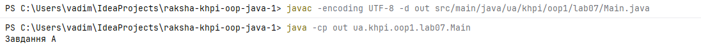
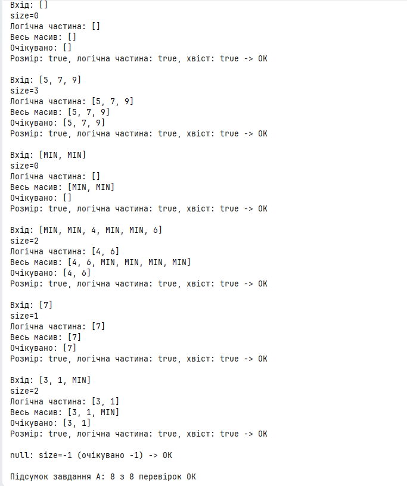

# Звіт з лабораторної роботи № 7

**Тема:** Алгоритми над одновимірними масивами
**Дисципліна:** Об'єктно-орієнтоване програмування (Java). Частина 1
**Студент:** `Ракша Вадим`, група `КН-925А`
**Варіант:** 1 (обов'язковий рівень), завдання A (поглиблений рівень)
**Pull Request:** `https://github.com/Nevalik/raksha-khpi-oop-java-1/pull/7`

## Налаштування середовища

| Параметр | Значення |
|---|---|
| JDK | 21 |
| IDE | IntelliJ IDEA |
| Репозиторій | `raksha-khpi-oop-java-1` |
| Гілка | `lab07` |
| Пакет | `ua.khpi.oop1.lab07` |
| Код | `src/main/java/ua/khpi/oop1/lab07/Main.java` (містить класи `Main` і `StableCompaction`) |

Компіляція і запуск:

```
javac -encoding UTF-8 -d out src/main/java/ua/khpi/oop1/lab07/Main.java
java -cp out ua.khpi.oop1.lab07.Main
```

Обидва класи розміщено в одному файлі `Main.java`, тому додаткових опцій компілятора не потрібно. Каталог `out/` додано до `.gitignore`. Collections Framework і Stream API не використовуються.



## Мета

Реалізувати базові алгоритми над одновимірним масивом, пояснити допустимі індекси та проміжні стани, перевірити збереження елементів під час пошуку й перетворення.

## Обов'язковий рівень — варіант 1

### Умова

Для непорожнього масиву знайти мінімум, його перший індекс і кількість входжень. Створити новий масив у початковому порядку без усіх елементів, рівних мінімуму; вхід не змінювати. Для порожнього масиву повернути визначений порожній результат.

### Контракт

| Елемент | Опис |
|---|---|
| Вхід | `int[] values` |
| Результат | мінімум, індекс його першого входження, кількість входжень, новий масив без мінімумів |
| Допустимі індекси | від `0` до `values.length - 1` |
| Порожній масив | мінімум відсутній, новий масив `[]` |
| Вхідний масив | не змінюється (перевіряється порівнянням із копією `values.clone()`) |
| Порожній масив у методах | `findMinimum` → `IllegalArgumentException` (мінімуму немає); `indexOfMinimum` → `-1`; `countOfMinimum` → `0`; `withoutMinimum` → `[]` |

**Обґрунтування винятку findMinimum:** мінімум для порожнього масиву не існує, тому `findMinimum` кидає `IllegalArgumentException`, щоб уникнути повернення «магічного» числа. У `process` перевірка `values.length == 0` стоїть *до* виклику, тому в робочому потоці виняток не виникає.

## Поглиблений рівень — A

### Умова

Масив містить покази датчика та спеціальне значення `Integer.MIN_VALUE` для пропущеного вимірювання. Перемістити всі коректні покази на початок того самого масиву зі збереженням їхнього порядку. Використати індекс читання й окремий індекс запису, повернути новий логічний розмір, хвіст заповнити спеціальним значенням.

### Контракт

| Елемент | Опис |
|---|---|
| Вхід | `int[] readings`; `Integer.MIN_VALUE` (далі `M`) означає пропуск |
| Результат | новий логічний розмір `size`; у `[0, size)` коректні покази в початковому порядку; у `[size, length)` значення `M` |
| Обмеження | другий масив не створюється, початковий масив є єдиним сховищем |
| Порожній масив | допустимий вхід, результат `0` |
| Некоректні дані | `null` → результат `-1` (логічного розміру немає) |

### Алгоритм (псевдокод)

```
write = 0
для read від 0 до length - 1:
    якщо readings[read] != M:
        readings[write] = readings[read]
        write = write + 1
для index від write до length - 1:
    readings[index] = M
повернути write
```

**Ключова ідея.** Завжди виконується `write <= read`, тому запис ніколи не затирає значення, яке ще не прочитане. Порядок зберігається, бо елементи копіюються по одному зліва направо. Після першого циклу `write` дорівнює кількості коректних показів, тобто новому логічному розміру. Решта масиву містить старі дані, тому другий цикл заповнює її значенням `M`.

## Аналіз задачі

- **Фізична довжина й логічний розмір.** У завданні A довжина масиву `length` не змінюється, а робочий діапазон визначає `size`. Логічна частина виводиться окремо, циклом до `size`, а не до `length`, щоб не опрацьовувати резервні значення `M`.
- **Допустимі індекси.** Усі цикли мають умову `index < length` (напіввідкритий діапазон `[0, length)`), тому вихід за межі неможливий.
- **Порожній масив.** Для варіанта 1 результат визначено до початку проходу (`values.length == 0`). Для завдання A цикли просто не виконуються, результат `0`.
- **Перший мінімум.** У `indexOfMinimum` повернення відбувається на першому збігу, тому результат є першим входженням.
- **Позначення.** У таблицях нижче `M = Integer.MIN_VALUE = -2147483648`. У виводі програми значення `Integer.MIN_VALUE` друкується як `MIN`.

## Структура класів

| Клас | Метод | Призначення |
|---|---|---|
| `Main` | `findMinimum(int[])` | мінімальне значення непорожнього масиву |
| `Main` | `indexOfMinimum(int[])` | індекс першого мінімуму |
| `Main` | `countOfMinimum(int[])` | кількість входжень мінімуму |
| `Main` | `withoutMinimum(int[])` | новий масив без усіх мінімумів |
| `Main` | `isSame(int[], int[])` | поелементне порівняння двох масивів |
| `Main` | `process(int[])` | обробка, вивід трьох проміжних станів і перевірка незмінності входу |
| `Main` | `main` | запуск завдання A, тестів варіанта 1 і введення з клавіатури |
| `StableCompaction` | `compact(int[], boolean)` | ущільнення на місці, повертає логічний розмір (`-1` для `null`); за `trace == true` друкує стан після кожного кроку, за `false` нічого не виводить |
| `StableCompaction` | `printStep(String, int[])` | друк одного рядка трасування |
| `StableCompaction` | `printArray(int[], int)` | друк перших `count` елементів масиву, `Integer.MIN_VALUE` показується як `MIN` |
| `StableCompaction` | `startsWith(int[], int[])` | чи збігаються перші `expected.length` елементів з очікуваними |
| `StableCompaction` | `check(int[], int[])` | ущільнення, друк входу, розміру, логічної частини й усього масиву, порівняння з очікуваним результатом, облік пройдених перевірок |
| `StableCompaction` | `checkNull()` | перевірка реакції на `null` (очікується `-1`) |
| `StableCompaction` | `runTaskA()` | трасування для одного набору, набір перевірок і підсумок завдання A |

## Алгоритми та опис програми

### Варіант 1

1. `findMinimum`: початкове значення береться з `values[0]`, цикл іде від індексу `1`, порівняння виконується з поточним мінімумом (а не із сусіднім елементом).
2. `indexOfMinimum`: перший `index`, для якого `values[index]` дорівнює мінімуму; якщо збігу немає або масив порожній, повертається -1.
3. `countOfMinimum`: лічильник стартує з `0`, цикл проходить весь масив і збільшує лічильник для кожного елемента, що дорівнює мінімуму. Метод не залежить від `indexOfMinimum`.
4. `withoutMinimum`: розмір нового масиву дорівнює `values.length - countOfMinimum(values)`; елементи, не рівні мінімуму, копіюються в початковому порядку з індексом запису `write`.
5. `process` показує три проміжні стани: крок 1 (мінімум та індекс), крок 2 (кількість входжень та розмір нового масиву), крок 3 (новий масив). Після цього друкуються вхідний масив після обробки й результат порівняння з копією.
6. У `main` після вбудованих тестів масив зчитується з клавіатури (елементи через пробіл) і також передається в `process`.

### Завдання A

Метод `compact(readings, trace)` реалізує псевдокод вище. Один і той самий алгоритм використовується і для трасування, і для перевірок: за `trace == false` метод нічого не виводить, за `trace == true` після кожного кроку друкує `read`, `write` та стан масиву (допоміжний метод `printStep`), а після заповнення хвоста друкує остаточний стан. Трасування використано для набору `[12, M, 8, M, 8]`.

Метод `check(readings, expected)` викликає `compact(readings, false)`, друкує вхід, `size`, логічну частину та весь масив, а потім перевіряє дві незалежні властивості:

1. розмір і логічна частина збігаються з очікуваним результатом (значення та порядок);
2. увесь хвіст `[size, length)` складається зі значень `M`.

Результат кожної перевірки друкується у вигляді `Розмір: …, логічна частина: …, хвіст: … -> OK/FAIL`; лічильники `passed` і `total` дають підсумок «8 з 8 перевірок OK». Окремий метод `checkNull` перевіряє, що для `null` повертається `-1`.

#### Проміжні кроки для `[12, M, 8, M, 8]`

| Крок | `read` | Елемент | `write` після кроку | Стан масиву |
|---|---|---|---|---|
| 1 | 0 | 12 (коректний) | 1 | `[12, M, 8, M, 8]` |
| 2 | 1 | `M` (пропуск) | 1 | `[12, M, 8, M, 8]` |
| 3 | 2 | 8 (коректний) | 2 | `[12, 8, 8, M, 8]` |
| 4 | 3 | `M` (пропуск) | 2 | `[12, 8, 8, M, 8]` |
| 5 | 4 | 8 (коректний) | 3 | `[12, 8, 8, M, 8]` |
| 6 | | заповнення хвоста від `write = 3` | 3 | `[12, 8, 8, M, M]` |

Новий логічний розмір дорівнює 3, логічна частина `[12, 8, 8]`. Остання комірка після кроку 5 ще містить старе значення `8`, тому хвіст явно заповнюється значенням `M`.

## Тестування і визначення набору даних

![Вивід варіанта 1: три проміжні стани для [4, 1, 3, 1]](assets/variant1-output.png)

![Вивід варіанта 1 для [2, 2] і порожнього масиву](assets/variant1-output2.png)

### Протокол перевірки: варіант 1

| № | Вхід | Очікувано | Фактично | Статус |
|---|---|---|---|---|
| 1 | `[4, 1, 3, 1]` | min=1, index=1, count=2, новий `[4, 3]` | min=1, index=1, count=2, новий `[4, 3]` | OK |
| 2 | `[2, 2]` | min=2, index=0, count=2, новий `[]` | min=2, index=0, count=2, новий `[]` | OK |
| 3 | `[]` | мінімум відсутній, новий `[]` | мінімум відсутній, новий `[]` | OK |
| 4 | `[7]` (власний: один елемент) | min=7, index=0, count=1, новий `[]` | min=7, index=0, count=1, новий `[]` | OK |
| 5 | `[-5, 3, -5, 8]` (власний: від'ємні) | min=-5, index=0, count=2, новий `[3, 8]` | min=-5, index=0, count=2, новий `[3, 8]` | OK |
| 6 | `[9, 4, 6, 2]` (власний: мінімум у кінці) | min=2, index=3, count=1, новий `[9, 4, 6]` | min=2, index=3, count=1, новий `[9, 4, 6]` | OK |

У випадках 1–2 та 4–6 після обробки виведено `Вхід не змінено: true`; для порожнього масиву (випадок 3) `process` завершується раніше, виводячи «Мінімум відсутній» і `Новий масив: []`.

![Трасування завдання A для [12, M, 8, M, 8]](assets/taskA-trace.png)

### Протокол перевірки: завдання A

| № | Вхід | Очікувано | Фактично | Статус |
|---|---|---|---|---|
| 1 | `[]` | size=0, логічна частина `[]` | size=0, логічна частина `[]` | OK |
| 2 | `[5, 7, 9]` (без пропусків) | size=3, логічна частина `[5, 7, 9]` | size=3, логічна частина `[5, 7, 9]` | OK |
| 3 | `[M, M]` (лише пропуски) | size=0, логічна частина `[]` | size=0, логічна частина `[]` | OK |
| 4 | `[M, M, 4, M, M, 6]` (кілька сусідніх пропусків) | size=2, логічна частина `[4, 6]` | size=2, логічна частина `[4, 6]` | OK |
| 5 | `[12, M, 8, M, 8]` (приклад з умови) | size=3, логічна частина `[12, 8, 8]` | size=3, логічна частина `[12, 8, 8]` | OK |
| 6 | `[7]` (власний: один елемент) | size=1, логічна частина `[7]` | size=1, логічна частина `[7]` | OK |
| 7 | `[3, 1, M]` (власний: пропуск у кінці) | size=2, логічна частина `[3, 1]` | size=2, логічна частина `[3, 1]` | OK |
| 8 | `null` | size=-1 | size=-1 | OK |

Для кожного випадку 1–7 додатково перевіряється, що весь хвіст `[size, length)` складається з `M`. Увесь масив після обробки для випадків 3, 4 і 7: `[M, M]`, `[4, 6, M, M, M, M]` та `[3, 1, M]` відповідно. Підсумок програми: `Підсумок завдання A: 8 з 8 перевірок OK`.



### Фрагмент фактичного виводу програми

У виводі `MIN` означає `Integer.MIN_VALUE`.

```
=== Завдання A ===
Вхід: [12, MIN, 8, MIN, 8]
  read=0, write=1: [12, MIN, 8, MIN, 8]
  read=1, write=1: [12, MIN, 8, MIN, 8]
  read=2, write=2: [12, 8, 8, MIN, 8]
  read=3, write=2: [12, 8, 8, MIN, 8]
  read=4, write=3: [12, 8, 8, MIN, 8]
  після заповнення хвоста: [12, 8, 8, MIN, MIN]
size=3
Логічна частина: [12, 8, 8]

...

Вхід: [MIN, MIN, 4, MIN, MIN, 6]
size=2
Логічна частина: [4, 6]
Весь масив: [4, 6, MIN, MIN, MIN, MIN]
Очікувано: [4, 6]
Розмір: true, логічна частина: true, хвіст: true -> OK

...

null: size=-1 (очікувано -1) -> OK

Підсумок завдання A: 8 з 8 перевірок OK

Вхід: [4, 1, 3, 1]
Крок 1: min=1, перший індекс=1
Крок 2: кількість входжень=2, розмір нового масиву=2
Крок 3: новий масив=[4, 3]
Вхід після обробки: [4, 1, 3, 1]
Вхід не змінено: true
```

### Перевірка за контрольним списком

- Алгоритми працюють лише з масивами та індексами, без Collections Framework і Stream API.
- Допустимий діапазон індексів і результат для порожнього масиву визначено до початку проходу.
- Початковий масив збережено для порівняння (`values.clone()`), показано три проміжні стани.
- Для завдання A перевірено порожній масив, один елемент, відсутність пропусків, лише пропуски та кілька сусідніх пропусків.
- Програма компілюється JDK 21 і дає однаковий результат з IDE та командного рядка.

## Висновки

У роботі реалізовано варіант 1: пошук мінімуму, індексу його першого входження та кількості входжень, а також побудову нового масиву без мінімумів зі збереженням порядку та без зміни входу. Строге порівняння `<` гарантує, що знайдено саме перший мінімум, а порівняння з поточним мінімумом (а не із сусіднім елементом) дає правильний результат для будь-якого розташування мінімуму.

У завданні A реалізовано стабільне ущільнення вимірювань на місці з двома індексами. Умова `write <= read` гарантує, що непрочитані значення не затираються, а порядок коректних показів зберігається. Різницю між фізичною довжиною масиву та логічним розміром показано окремим виведенням логічної частини й усього масиву. Усі контрольні набори, зокрема порожній масив, один елемент, відсутність пропусків, лише пропуски та сусідні пропуски, а також `null`, дали очікуваний результат (8 з 8 перевірок).

Для порожнього масиву метод `findMinimum` кидає `IllegalArgumentException`, тому `process` перевіряє `values.length == 0` до його виклику й виводить «Мінімум відсутній».