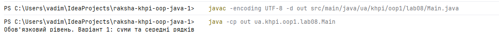
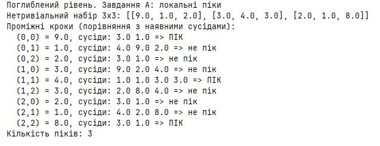
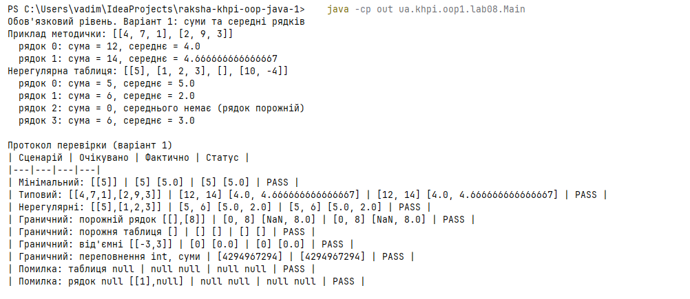
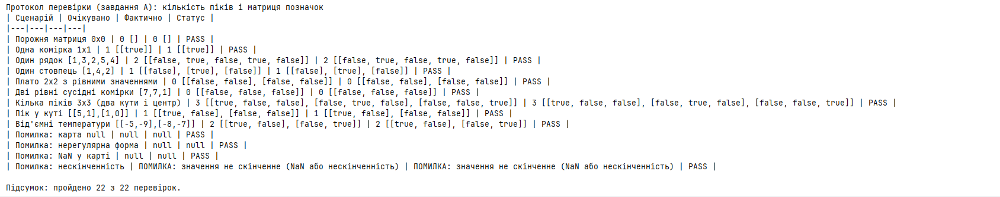

# Звіт з лабораторної роботи № 8

- **Тема:** Матриці та навчальна структура даних на основі масиву
- **Дисципліна:** Об'єктно-орієнтоване програмування (Java). Частина 1
- **Студент:** Ракша Вадим КН-925
- **Номер у списку :** 17 **Варіант 1**; поглиблений рівень - **A** (непарний варіант)
- **Pull Request:** [URL Pull Request із lab08](https://github.com/Nevalik/raksha-khpi-oop-java-1/pull/8)

## Налаштування середовища

- JDK 21, Git, IntelliJ IDEA.
- Репозиторій: `raksha-khpi-oop-java-1`, гілка `lab08` створена від актуальної `main`.
- Код: `src/main/java/ua/khpi/oop1/lab08/Main.java`, пакет `ua.khpi.oop1.lab08`.
- Складання вручну (Maven і Gradle не використовуються), результат у `out/` (додано до `.gitignore`):

```
javac -encoding UTF-8 -d out src/main/java/ua/khpi/oop1/lab08/Main.java
java -cp out ua.khpi.oop1.lab08.Main
```

**Компіляція та запуск** у командному рядку :




## Посилання на код та алгоритми

- Вихідний код: [`Main.java`](../../src/main/java/ua/khpi/oop1/lab08/Main.java)
- Алгоритм варіанта 1: розділ «Обов'язковий рівень», підрозділ «Алгоритм» (метод `rowSums`, `rowAverages`)
- Алгоритм завдання A: розділ «Поглиблений рівень», підрозділ «Псевдокод» (методи `peakMap`, `isLocalPeak`)

## Мета

Опрацювати прямокутні й нерегулярні масиви та реалізувати матричну операцію з явним контролем розмірів.

## Обов'язковий рівень - варіант 1

**Завдання.** Обчислити суми та середні значення кожного рядка нерегулярної таблиці. Порожній рядок має суму нуль і не має середнього; останнє позначити явно.

### Аналіз задачі (контракт)

| Пункт | Опис |
|---|---|
| Вхід | `int[][] table`: таблиця цілих чисел, рядки можуть мати різну довжину, рядок може бути порожнім |
| Передумова | `table != null` і кожний `table[row] != null` |
| Вихід | `long[] rowSums` довжини `table.length`; `double[] rowAverages` довжини `table.length` |
| Суми | накопичуються в `long` (уникаємо переповнення `int`) |
| Середні | `(double) sum / table[row].length`; обчислюються в `double` |
| Порожній рядок | сума `0`, середнього немає; позначається `Double.NaN` (нуль був би реальним середнім) |
| Порожня таблиця (`[]`) | результат: порожні масиви `[]` |
| Некоректний вхід | `table == null` або рядок `null`: методи повертають `null`; причину визначає `validateJagged` (`STATUS_TABLE_NULL`, `STATUS_BAD_ROW`) |

### Структура програми

Усі методи статичні, обчислення відокремлені від консольного подання.

| Метод | Призначення |
|---|---|
| `validateJagged(int[][])` | перевірка таблиці до обчислення, повертає код статусу |
| `rowSums(int[][])` | суми рядків |
| `rowAverages(int[][])` | середні рядків (`NaN` для порожнього рядка) |
| `jaggedText`, `printJagged`, `testVariant1`, `check`, `printProtocolHeader` | консольне подання та протокол перевірки |

### Алгоритм

Подвійний обхід, внутрішній цикл обмежується довжиною **поточного** рядка `table[row].length`, а не першого:

```
для row від 0 до table.length - 1:
    для column від 0 до table[row].length - 1:
        sums[row] += table[row][column]
для row від 0 до table.length - 1:
    якщо table[row].length == 0: averages[row] = NaN
    інакше: averages[row] = sums[row] / table[row].length
```

Інваріант: після обробки рядка `row` значення `sums[row]` дорівнює сумі всіх елементів цього рядка.

## Поглиблений рівень - A. Локальні піки температурної карти

### Аналіз задачі (контракт)

| Пункт | Опис |
|---|---|
| Вхід | `double[][] map`: прямокутна матриця скінченних температур |
| Вихід | `boolean[][] peaks` тих самих розмірів; `countPeaks` повертає кількість піків |
| Означення | комірка є піком, якщо її значення **строго більше** за значення всіх **наявних** сусідів згори, знизу, ліворуч, праворуч |
| Обмеження | карта не `null`, рядки не `null`, усі рядки однакової довжини, усі значення скінченні |
| Некоректний вхід | `peakMap` повертає `null`; причину дає `validateTemperatureMap`: `STATUS_TABLE_NULL`, `STATUS_BAD_ROW` (null-рядок або різна довжина), `STATUS_NOT_FINITE` (NaN, ±∞) |
| Особливі випадки | `0×0`: піків немає; `1×1`: єдина комірка є піком; плато з рівними значеннями: піків немає |

### Ключова ідея

Сусіди задаються зміщеннями координат (див. розділ 3.13 методички):

```
dRow    = {-1, 1,  0, 0}     // згори, знизу, ліворуч, праворуч
dColumn = { 0, 0, -1, 1}
```

Для кожного напрямку обчислюється координата сусіда й **перед доступом** перевіряється, що вона в межах матриці. Сусід поза межами не існує, тому не порівнюється: фіктивні значення (наприклад, `-∞`) не вводяться. Якщо хоча б один наявний сусід має значення `≥` значення комірки, комірка не є піком. Для кутових і крайових комірок перевіряється менше сусідів (2 і 3 відповідно), тому саме ця перевірка меж забезпечує коректність на краях.

### Псевдокод

```
validateTemperatureMap(map) → статус          // до пошуку
peakMap(map):
    якщо статус ≠ OK: повернути null
    peaks = нова boolean-матриця тих самих розмірів
    для кожної комірки (row, column):
        peaks[row][column] = isLocalPeak(map, row, column)
    повернути peaks
isLocalPeak(map, row, column):
    для кожного з 4 напрямків d:
        nr = row + dRow[d]; nc = column + dColumn[d]
        якщо isInside(map, nr, nc) І map[row][column] ≤ map[nr][nc]:
            повернути false
    повернути true
countPeaks(peaks): лічильник елементів true
```

Складність: `O(r·c)` за часом (кожна комірка порівнюється зі сталою кількістю сусідів), додаткова пам'ять `O(r·c)` для матриці позначок.

### Проміжні кроки для нетривіального набору (3×3)

```
[9.0, 1.0, 2.0]
[3.0, 4.0, 3.0]
[2.0, 1.0, 8.0]
```

| Комірка | Значення | Наявні сусіди (згори; знизу; ліворуч; праворуч) | Результат |
|---|---|---|---|
| (0,0) | 9.0 | -; 3.0; -; 1.0 | **ПІК** |
| (0,1) | 1.0 | -; 4.0; 9.0; 2.0 | не пік |
| (0,2) | 2.0 | -; 3.0; 1.0; - | не пік |
| (1,0) | 3.0 | 9.0; 2.0; -; 4.0 | не пік |
| (1,1) | 4.0 | 1.0; 1.0; 3.0; 3.0 | **ПІК** |
| (1,2) | 3.0 | 2.0; 8.0; 4.0; - | не пік |
| (2,0) | 2.0 | 3.0; -; -; 1.0 | не пік |
| (2,1) | 1.0 | 4.0; -; 2.0; 8.0 | не пік |
| (2,2) | 8.0 | 3.0; -; 1.0; - | **ПІК** |

Матриця піків: `[[true, false, false], [false, true, false], [false, false, true]]`, кількість піків: **3** (два кути й центр).

**Консольний вивід** проміжних кроків для набору 3×3 (порівняння кожної комірки з наявними сусідами):



## Структура класів

Лабораторна робота використовує один клас `Main` зі статичними методами та константами статусу (`STATUS_OK`, `STATUS_TABLE_NULL`, `STATUS_BAD_ROW`, `STATUS_NOT_FINITE`). Власні класи, колекції та виключення не застосовуються, оскільки відповідні теми ще не вивчено; помилки подано явним статусом (див. розділ 3.12 методички).

Методи завдання A: `validateTemperatureMap`, `isInside`, `isLocalPeak`, `peakMap`, `countPeaks`; допоміжні масиви зміщень `NEIGHBOR_ROW_SHIFT`, `NEIGHBOR_COLUMN_SHIFT`.

## Алгоритми та опис програми

Програма запускається з IDE та командного рядка однаково. `main` послідовно виконує `testVariant1()` (демонстрація та протокол варіанта 1) і `testTaskA()` (трасування та протокол завдання A) та друкує підсумок.

## Тестування і визначення набору даних

Усі очікувані значення обчислені вручну до запуску програми. Результат запуску: **пройдено 22 з 22 перевірок**.

### Протокол перевірки: варіант 1

| № | Вхід | Очікувано (суми і середні) | Фактично | Статус |
|---|---|---|---|---|
| 1 | Мінімальний `[[5]]` | `[5] [5.0]` | `[5] [5.0]` | PASS |
| 2 | Типовий `[[4,7,1],[2,9,3]]` | `[12, 14] [4.0, 4.666666666666667]` | `[12, 14] [4.0, 4.666666666666667]` | PASS |
| 3 | Нерегулярний `[[5],[1,2,3]]` | `[5, 6] [5.0, 2.0]` | `[5, 6] [5.0, 2.0]` | PASS |
| 4 | Граничний: порожній рядок `[[],[8]]` | `[0, 8] [NaN, 8.0]` | `[0, 8] [NaN, 8.0]` | PASS |
| 5 | Граничний: порожня таблиця `[]` | `[] []` | `[] []` | PASS |
| 6 | Граничний: від'ємні `[[-3,3]]` | `[0] [0.0]` | `[0] [0.0]` | PASS |
| 7 | Граничний: два `Integer.MAX_VALUE`, суми | `[4294967294]` | `[4294967294]` | PASS |
| 8 | Помилка: таблиця `null` | `null null` | `null null` | PASS |
| 9 | Помилка: рядок `null` `[[1],null]` | `null null` | `null null` | PASS |

**Консольний вивід варіанта 1**: приклад із методички, нерегулярна таблиця та протокол перевірки (усі рядки PASS):



### Протокол перевірки: завдання A

| № | Вхід | Очікувано | Фактично | Статус |
|---|---|---|---|---|
| 1 | Порожня матриця 0×0 | `0 []` | `0 []` | PASS |
| 2 | Одна комірка 1×1 `[[5]]` | `1 [[true]]` | `1 [[true]]` | PASS |
| 3 | Один рядок `[1,3,2,5,4]` | `2 [[false, true, false, true, false]]` | `2 [[false, true, false, true, false]]` | PASS |
| 4 | Один стовпець `[1],[4],[2]` | `1 [[false], [true], [false]]` | `1 [[false], [true], [false]]` | PASS |
| 5 | Плато 2×2 з рівними значеннями | `0 [[false, false], [false, false]]` | `0 [[false, false], [false, false]]` | PASS |
| 6 | Дві рівні сусідні комірки `[7,7,1]` | `0 [[false, false, false]]` | `0 [[false, false, false]]` | PASS |
| 7 | Кілька піків 3×3 (два кути й центр) | `3 [[true, false, false], [false, true, false], [false, false, true]]` | збігається | PASS |
| 8 | Пік у куті `[[5,1],[1,0]]` | `1 [[true, false], [false, false]]` | збігається | PASS |
| 9 | Від'ємні `[[-5,-9],[-8,-7]]` | `2 [[true, false], [false, true]]` | збігається | PASS |
| 10 | Помилка: карта `null` | `null` | `null` | PASS |
| 11 | Помилка: нерегулярна форма | `null` | `null` | PASS |
| 12 | Помилка: `NaN` у карті | `null` | `null` | PASS |
| 13 | Помилка: `+∞`, статус | значення не скінченне | значення не скінченне | PASS |

Власний граничний набір (рядки 2-6, 9) охоплює вимоги завдання: 0×0, 1×1, один рядок, плато з рівними значеннями та кілька піків.

**Консольний вивід протоколу завдання A** та підсумковий рядок «пройдено 22 з 22 перевірок»:



## Висновки

У роботі опрацьовано двовимірні масиви Java як масиви посилань на рядки: для нерегулярної таблиці внутрішній цикл обмежується довжиною поточного рядка, а не першого. Реалізовано суми та середні рядків (варіант 1) з явним позначенням відсутності середнього для порожнього рядка (`NaN`) та накопиченням у `long`. У завданні A реалізовано пошук строгих локальних піків із перевіркою прямокутності й скінченності до обчислення та з перевіркою меж перед доступом до кожного сусіда, що забезпечує коректну обробку кутових і крайових комірок без фіктивних значень. Усі 22 перевірки протоколу виконано успішно.