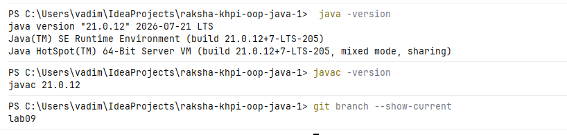
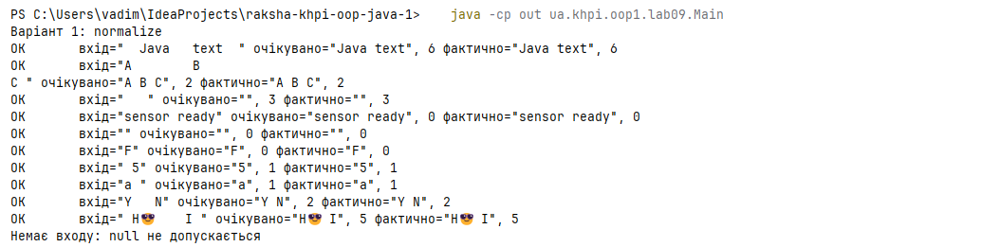
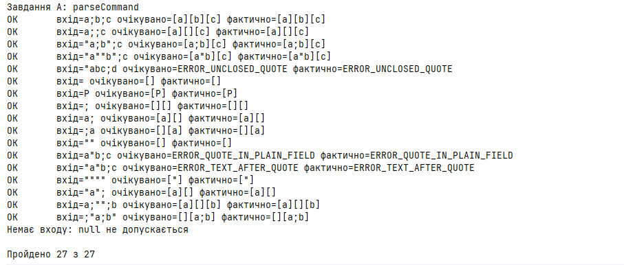

# Звіт з лабораторної роботи № 9

**Тема:** Рядки, нормалізація та форматування тексту без регулярних виразів

**Студент:** Ракша Вадим КН-925А

**Варіант:** 1; Поглиблений рівень - завдання A (непарний варіант)

**Код:** [`Main.java`](../../src/main/java/ua/khpi/oop1/lab09/Main.java)

**Pull Request:** https://github.com/Nevalik/raksha-khpi-oop-java-1/pull/10

## Налаштування середовища

- JDK 21, Git, навчальний репозиторій `raksha-khpi-oop-java-1`.
- Гілка `lab09`, пакет `ua.khpi.oop1.lab09`.
- Складання вручну (Maven і Gradle не використовуються), результат у каталозі `out/`, який додано до `.gitignore`:

```bash
javac -encoding UTF-8 -d out src/main/java/ua/khpi/oop1/lab09/Main.java
java -cp out ua.khpi.oop1.lab09.Main
```



## Мета

Реалізувати посимвольну обробку тексту без регулярних виразів, коректно використовуючи `String`, `StringBuilder`, індекси та правила формування результату.

## Обов'язковий рівень - варіант 1

Нормалізувати послідовності символів, для яких `Character.isWhitespace` повертає `true`, до одного пробілу та прибрати пробіли по краях. Додатково повернути кількість вилучених одиниць UTF-16, розширюючи наведений у методичці приклад.

Реалізація: методи `normalize` та `removedUnits` у [`Main.java`](../../src/main/java/ua/khpi/oop1/lab09/Main.java).

## Поглиблений рівень - A

Завдання A: розбір командного рядка з лапками. Поля розділені крапкою з комою; поле можна взяти в подвійні лапки, усередині лапок `;` є звичайним символом, а дві сусідні лапки означають одну лапку в результаті.

Реалізація: метод `parseCommand` у [`Main.java`](../../src/main/java/ua/khpi/oop1/lab09/Main.java). Алгоритм описано в розділі «Алгоритми та опис програми».

## Аналіз задачі

### Обов'язковий рівень

| Елемент | Опис |
|---|---|
| Вхід | рядок `source`, відмінний від `null` |
| Результат | нормалізований рядок і кількість вилучених одиниць UTF-16 |
| Обмеження | одиницею обробки є `char` (кодова одиниця UTF-16) |
| Відсутній вхід | `null` відхиляється на вході програми (у `checkNormalize`, який викликає `main`) повідомленням `Немає входу: null не допускається` |
| Порожній рядок | результат - порожній рядок, вилучено 0 |
| Лише пробіли | результат - порожній рядок, вилучено `length()` одиниць |

Кількість вилучених одиниць дорівнює `source.length() - normalized.length()`. Заміна табуляції чи переносу на пробіл довжину не змінює, тому в `"A\tB"` вилучених одиниць 0.

### Поглиблений рівень (контракт)

| Елемент | Опис |
|---|---|
| Вхід | рядок `line` (не `null`) з полями, розділеними `;` |
| Результат | кількість полів і самі поля (у масиві `fields`), або від'ємний код помилки |
| Лапки | поле можна взяти в `"`; усередині лапок `;` - звичайний символ; `""` усередині лапок дає одну `"` |
| Порожні поля | зберігаються, зокрема на початку й наприкінці рядка |
| Порожній вхід | одне порожнє поле |
| Помилки | `-1` незакриті лапки; `-2` лапка всередині нецитованого поля; `-3` звичайний текст після закривальної лапки |
| Відсутній вхід | `null` відхиляється на вході програми (у `checkCommand`, який викликає `main`) повідомленням `Немає входу: null не допускається` |

Після закривальної лапки дозволені лише роздільник або кінець входу.

Розмір масиву `fields` має бути не меншим за `line.length() + 1`: найбільше полів дає рядок з самих `;`, і їх на одне більше, ніж роздільників.

## Структура класів

Усе рішення міститься в одному класі `Main` зі статичними методами. Обчислення відокремлено від консольного подання.

| Метод | Призначення |
|---|---|
| `normalize(String)` | нормалізація пробілів (обчислення) |
| `removedUnits(String, String)` | кількість вилучених одиниць UTF-16 (обчислення) |
| `parseCommand(String, String[])` | розбір командного рядка автоматом станів (обчислення) |
| `parseToText(String)` | текстове подання результату розбору |
| `check`, `checkNormalize`, `checkCommand`, `main` | консольне подання й протокол перевірки |

Константи `STATE_*` задають стани автомата, а `ERROR_*` - коди помилок розбору. Лічильники `total` і `passed` потрібні для підсумкового рядка протоколу.

## Алгоритми та опис програми

### Нормалізація пробілів (варіант 1)

Один посимвольний прохід із `StringBuilder` і логічною ознакою `separatorPending` (прийом з розділу 3.6 методички):

1. Якщо символ пробільний, запам'ятати, що потрібен роздільник, але лише коли в результаті вже є текст. Так пробіли на початку відкидаються.
2. Якщо символ непробільний: якщо роздільник очікується, додати один пробіл, потім додати сам символ.
3. Пробіли наприкінці не потрапляють до результату, бо роздільник додається лише перед наступним непробільним символом.

Бібліотечні `trim` і `strip` не потрібні. Складність за часом і пам'яттю лінійна від довжини рядка.

### Розбір командного рядка (завдання A)

**Стани автомата.**

| Стан | Зміст |
|---|---|
| `START` | початок поля |
| `PLAIN` | поле без лапок |
| `QUOTED` | усередині лапок |
| `AFTER_QUOTE` | позиція після закривальної лапки |

**Пояснення вибору станів і правил формату.**

- Один пошук `indexOf(';')` не годиться, бо `;` усередині лапок належить полю. Тому під час проходу зберігається стан.
- `START` потрібен, щоб відрізнити початок поля (там лапка відкриває цитовану частину) від середини нецитованого поля (там лапка є помилкою `-2`). Він також дає порожні поля: `;` у стані `START` додає порожнє поле.
- `QUOTED` робить `;` звичайним символом.
- Дві сусідні лапки в `QUOTED` розпізнаються загляданням на один символ уперед: якщо після лапки йде ще одна, додається одна лапка й друга пропускається. Перед `charAt(index + 1)` перевіряється межа `index + 1 < line.length()`, щоб не вийти за межі рядка.
- `AFTER_QUOTE` потрібен, щоб після закривальної лапки допускалися лише роздільник або кінець входу, а будь-який інший символ давав помилку `-3`.
- Якщо вхід закінчився в стані `QUOTED`, лапки не закрито (помилка `-1`).
- Помилки подано окремими від'ємними кодами, щоб їх можна було відрізнити від кількості полів і одну від одної.

**Таблиця переходів.**

| Стан | Символ | Дія | Наступний стан |
|---|---|---|---|
| START | `;` (роздільник) | додати порожнє поле | START |
| START | `"` (лапка) | нічого | QUOTED |
| START | звичайний | додати до поля | PLAIN |
| PLAIN | `;` | завершити поле | START |
| PLAIN | `"` | помилка `-2` | - |
| PLAIN | звичайний | додати до поля | PLAIN |
| QUOTED | `;` | додати до поля | QUOTED |
| QUOTED | `"`, за нею ще `"` | додати одну `"`, пропустити другу | QUOTED |
| QUOTED | `"`, наступний символ не `"` | нічого (кінець цитованої частини) | AFTER_QUOTE |
| QUOTED | звичайний | додати до поля | QUOTED |
| AFTER_QUOTE | `;` | завершити поле | START |
| AFTER_QUOTE | будь-що інше | помилка `-3` | - |
| кінець входу | - | у QUOTED помилка `-1`; в інших станах додати останнє поле | - |

**Псевдокод.**

```text
state = START; count = 0; field = ""
для кожного символу s з індексом i:
    START:       ';' -> fields[count++] = ""
                 '"' -> state = QUOTED
                 інакше -> field += s; state = PLAIN
    PLAIN:       ';' -> fields[count++] = field; field = ""; state = START
                 '"' -> повернути -2
                 інакше -> field += s
    QUOTED:      '"' і наступний теж '"' -> field += '"'; i++
                 '"' інакше -> state = AFTER_QUOTE
                 інакше -> field += s
    AFTER_QUOTE: ';' -> fields[count++] = field; field = ""; state = START
                 інакше -> повернути -3
якщо state == QUOTED -> повернути -1
fields[count++] = field
повернути count
```

**Проміжні кроки для рядка `"a""b";c`.**

| i | Символ | Стан до | Дія | Стан після | field | Поля |
|---|---|---|---|---|---|---|
| 0 | `"` | START | початок цитованого поля | QUOTED | (порожньо) | - |
| 1 | `a` | QUOTED | додати | QUOTED | `a` | - |
| 2 | `"` | QUOTED | наступна теж `"`: додати `"`, пропустити | QUOTED | `a"` | - |
| 4 | `b` | QUOTED | додати | QUOTED | `a"b` | - |
| 5 | `"` | QUOTED | наступна `;`: кінець цитованої частини | AFTER_QUOTE | `a"b` | - |
| 6 | `;` | AFTER_QUOTE | завершити поле | START | (порожньо) | `a"b` |
| 7 | `c` | START | початок поля | PLAIN | `c` | `a"b` |
| кінець | - | PLAIN | додати останнє поле | - | - | `a"b`, `c` |

Індекс 3 пропущено, бо друга лапка пари була пропущена на кроці `i = 2`. Результат: `[a"b][c]`, 2 поля.

## Тестування і визначення набору даних

Тести запускаються командою `java -cp out ua.khpi.oop1.lab09.Main`. У записі результату розбору `[...]` кожне поле взято в квадратні дужки, тому порожнє поле видно як `[]`. Усього виконується 27 перевірок: 10 для обов'язкового рівня та 17 для поглибленого. Два випадки `null` (по одному на кожен рівень) відхиляються повідомленням і до лічильника перевірок не входять.





### Обов'язковий рівень

Набір охоплює порожній рядок, один символ, лише пробіли, пробіли на краях, кілька пробілів підряд, табуляцію й перенесення рядка, символ поза базовою площиною та відсутній вхід.

| № | Вхід | Очікувано | Фактично | Статус |
|---|---|---|---|---|
| 1 | `"  Java   text  "` (типовий) | `"Java text"`, 6 | `"Java text"`, 6 | ОК |
| 2 | `"A\tB \nC "` (табуляція, перенесення) | `"A B C"`, 2 | `"A B C"`, 2 | ОК |
| 3 | `"   "` (лише пробіли, граничний) | `""`, 3 | `""`, 3 | ОК |
| 4 | `"sensor ready"` (уже нормалізовано) | `"sensor ready"`, 0 | `"sensor ready"`, 0 | ОК |
| 5 | `""` (мінімальний) | `""`, 0 | `""`, 0 | ОК |
| 6 | `"F"` (один символ) | `"F"`, 0 | `"F"`, 0 | ОК |
| 7 | `" 5"` (пробіл на початку) | `"5"`, 1 | `"5"`, 1 | ОК |
| 8 | `"a "` (пробіл наприкінці) | `"a"`, 1 | `"a"`, 1 | ОК |
| 9 | `"Y   N"` (кілька пробілів усередині) | `"Y N"`, 2 | `"Y N"`, 2 | ОК |
| 10 | `" H😎    I "` (сурогатна пара, 4 пробіли між `😎` і `I`) | `"H😎 I"`, 5 | `"H😎 I"`, 5 | ОК |
| -- | `null` (помилка) | повідомлення про відсутній вхід | `Немає входу: null не допускається` | ОК |

У тесті 10 початкова довжина дорівнює 10 одиницям UTF-16 (пробіл, `H`, дві одиниці `😎`, чотири пробіли, `I`, пробіл), результат - 5, тобто вилучено 5.

### Поглиблений рівень

Набір охоплює рядки з умови (включно з незакритими лапками), порожній рядок, один символ, лише роздільник, порожні поля на початку й наприкінці, порожнє цитоване поле, обидва види некоректних лапок, власні граничні випадки та відсутній вхід.

| № | Вхід | Очікувано | Фактично | Статус |
|---|---|---|---|---|
| 1 | `a;b;c` | `[a][b][c]` | `[a][b][c]` | ОК |
| 2 | `a;;c` | `[a][][c]` | `[a][][c]` | ОК |
| 3 | `"a;b";c` | `[a;b][c]` | `[a;b][c]` | ОК |
| 4 | `"a""b";c` | `[a"b][c]` | `[a"b][c]` | ОК |
| 5 | `"abc;d` (незакриті лапки) | `ERROR_UNCLOSED_QUOTE` | `ERROR_UNCLOSED_QUOTE` | ОК |
| 6 | порожній рядок | `[]` | `[]` | ОК |
| 7 | `Р` (один символ) | `[Р]` | `[Р]` | ОК |
| 8 | `;` (лише роздільник) | `[][]` | `[][]` | ОК |
| 9 | `a;` (порожнє поле в кінці) | `[a][]` | `[a][]` | ОК |
| 10 | `;a` (порожнє поле на початку) | `[][a]` | `[][a]` | ОК |
| 11 | `""` (порожнє цитоване поле) | `[]` | `[]` | ОК |
| 12 | `a"b;c` (лапка в нецитованому полі) | `ERROR_QUOTE_IN_PLAIN_FIELD` | `ERROR_QUOTE_IN_PLAIN_FIELD` | ОК |
| 13 | `"a"b;c` (текст після лапки) | `ERROR_TEXT_AFTER_QUOTE` | `ERROR_TEXT_AFTER_QUOTE` | ОК |
| 14 | `""""` (власний: поле з однієї лапки) | `["]` | `["]` | ОК |
| 15 | `"a";` (власний: кінцевий роздільник після лапки) | `[a][]` | `[a][]` | ОК |
| 16 | `a;"";b` (власний: порожнє цитоване поле всередині) | `[a][][b]` | `[a][][b]` | ОК |
| 17 | `;"a;b"` (власний: порожнє поле, потім цитоване з `;`) | `[][a;b]` | `[][a;b]` | ОК |
| -- | `null` (помилка) | повідомлення про відсутній вхід | `Немає входу: null не допускається` | ОК |

Підсумковий рядок протоколу: `Пройдено 27 з 27`.

## Висновки

1. Нормалізацію пробілів реалізовано одним посимвольним проходом із `StringBuilder` та ознакою `separatorPending`, без регулярних виразів і без `trim`/`strip`. Кількість вилучених одиниць UTF-16 обчислюється як різниця довжин початкового й нормалізованого рядків.
2. Розбір командного рядка з лапками реалізовано власним автоматом із чотирьох станів. Порожні поля зберігаються, а три види некоректного формату повертають окремі коди помилок.
3. Усі 27 перевірок (10 для обов'язкового рівня та 17 для поглибленого) дали очікуваний результат. Випадок `null` у обох рівнях відхиляється явним повідомленням.
4. Фактична одиниця обробки - кодова одиниця `char` (UTF-16). Для тексту з латиниці, кирилиці та ASCII-роздільників алгоритми працюють правильно. Сурогатні пари символів поза базовою площиною нормалізація не розриває, бо їхні половини не є пробільними, але кількість вилучених одиниць рахується саме в одиницях UTF-16, а не в кодових точках. Розбір командного рядка теж не пошкоджує такі символи, бо роздільник і лапка є ASCII-символами, а сурогатна пара копіюється в поле цілком.