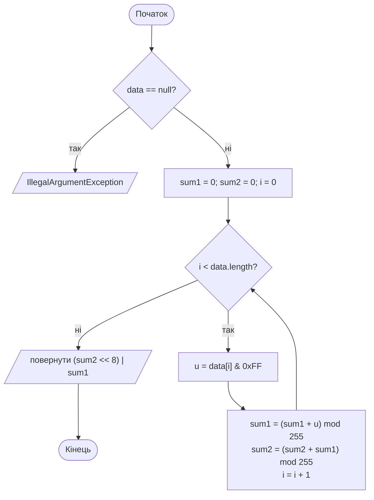
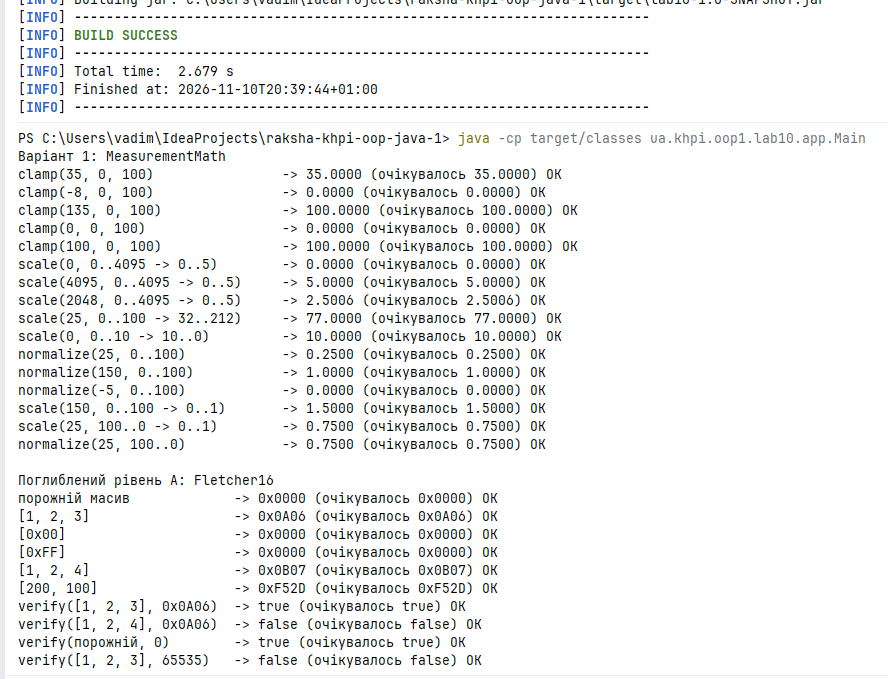
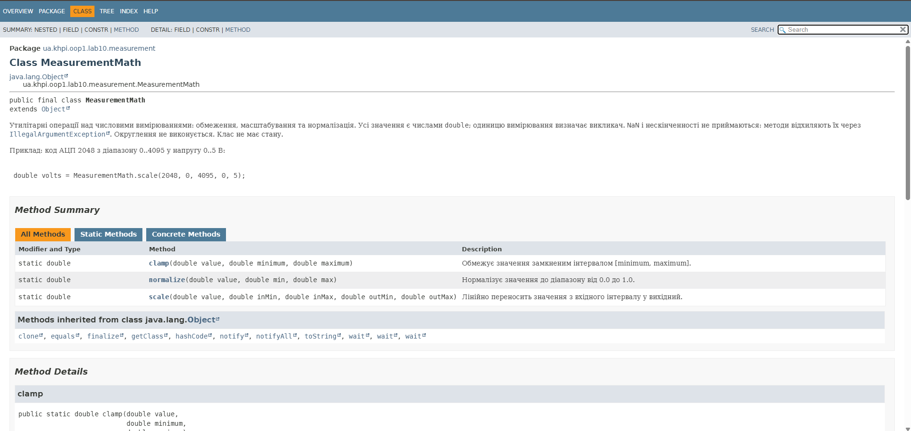
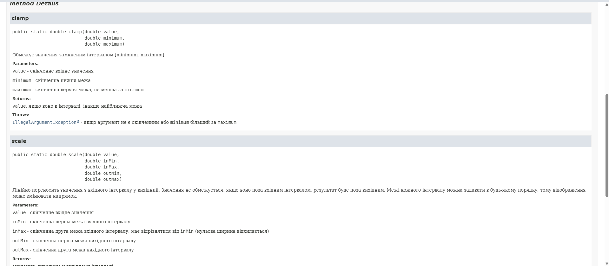

# Звіт з лабораторної роботи № 10

- **Тема:** Багатофайлова програма, утилітарний API та Javadoc
- **Дисципліна:** Об'єктно-орієнтоване програмування (Java). Частина 1
- **Студент:** Ракша Вадим КН-925А, місце в списку групи - 17
- **Гілка:** `lab10`
- **Pull Request:** [URL Pull Request №11](https://github.com/Nevalik/raksha-khpi-oop-java-1/pull/11)

## Налаштування середовища

| Компонент | Версія |
|---|---|
| ОС | Windows 11 |
| JDK | 21 (`java -version`: "21.0.12" 2026-07-21 LTS) |
| Maven | Apache Maven 3.10.0 (`mvn -v`) |
| Git | 2.53.0.windows.1 (`git --version`) |
| IDE |IntelliJ IDEA  2026.2.3 |

## Мета

Побудувати багатофайлову Java-програму з узгодженими пакетами, вузьким утилітарним API, документацією Javadoc, скласти її Maven і з командного рядка.

## Обов'язковий рівень - варіант 1

Номер варіанта: 1 (17 номер у групі)

**Завдання:** створити утилітарний клас для обмеження, масштабування та нормалізації числових вимірювань. Визначити вхідний і вихідний інтервали та відхиляти вхідний інтервал нульової ширини.

## Поглиблений рівень - A

Номер основного варіанта непарний, тому виконується завдання **A - контрольна сума Fletcher-16**.

## Аналіз задачі

### Варіант 1: `MeasurementMath`

| Метод | Вхід | Результат | Некоректні дані |
|---|---|---|---|
| `clamp(value, minimum, maximum)` | три скінченні `double` | `value`, якщо він у `[minimum, maximum]`, інакше найближча межа | `IllegalArgumentException`, якщо аргумент не скінченний або `minimum > maximum` |
| `scale(value, inMin, inMax, outMin, outMax)` | п'ять скінченних `double` | лінійне відображення з вхідного інтервалу у вихідний, без обмеження | `IllegalArgumentException`, якщо аргумент не скінченний, `inMin == inMax` або результат не скінченний |
| `normalize(value, min, max)` | три скінченні `double` | число від 0.0 до 1.0 (значення спершу обмежується інтервалом) | `IllegalArgumentException`, якщо аргумент не скінченний або `min == max` |

Формула масштабування:

```text
результат = outMin + (value - inMin) / (inMax - inMin) · (outMax - outMin)
```

Межі інтервалів можна задавати в будь-якому порядку, тому відображення може змінювати напрямок (наприклад, `0..10 → 10..0`). Нульова ширина (`inMin == inMax`) відхиляється, бо ділення на нуль не дає скінченного результату. `NaN` і нескінченності відхиляються через `Double.isFinite`.

### Завдання A: Fletcher-16

- **Вхід:** `byte[] data` (не `null`), для `verify` ще й `int expected`.
- **Результат:** `int` від 0 до 65535, формат `(sum2 << 8) | sum1`.
- **Некоректні дані:** `null` і `expected` поза `0..65535` дають `IllegalArgumentException`.
- **Особливий випадок:** порожній масив дає 0.
- **Обмеження:** сума виявляє частину помилок передавання, але не є криптографічним захистом. Зокрема, `0x00` і `0xFF` дають однакову остачу за модулем 255.

## Структура класів

```text
src/main/java/ua/khpi/oop1/lab10/
├── app/Main.java                     демонстрація, консольне подання
├── measurement/MeasurementMath.java  утилітарний клас варіанта 1
└── checksum/Fletcher16.java          утилітарний клас завдання A
```

Залежності односпрямовані: `app → measurement`, `app → checksum`. Пакети `measurement` і `checksum` не імпортують `app` і не залежать одне від одного.

| Клас | Публічний API | Закрите |
|---|---|---|
| `MeasurementMath` | `clamp`, `scale`, `normalize` | конструктор, допоміжний `requireFinite` |
| `Fletcher16` | `compute`, `verify` | конструктор, константи `MODULUS` і `MAX_VALUE` |
| `Main` | `main` | конструктор, допоміжні методи виведення |

Обидва утилітарні класи оголошені `final`, мають закритий конструктор і лише статичні методи, стану не мають. Допоміжний метод, який потрібен тільки всередині класу, залишено `private`.

### Посилання на код та алгоритм

| Що | Де |
|---|---|
| Утилітарний клас варіанта 1 | [`MeasurementMath.java`](../../src/main/java/ua/khpi/oop1/lab10/measurement/MeasurementMath.java) |
| Утилітарний клас завдання A (реалізація алгоритму) | [`Fletcher16.java`](../../src/main/java/ua/khpi/oop1/lab10/checksum/Fletcher16.java) |
| Демонстрація | [`Main.java`](../../src/main/java/ua/khpi/oop1/lab10/app/Main.java) |
| Опис алгоритму Fletcher-16 (псевдокод, блок-схема, кроки) | [нижче в цьому звіті](#алгоритм-fletcher-16-псевдокод) |
| Конфігурація складання | [`pom.xml`](../../pom.xml) |

## Алгоритми та опис програми

### Алгоритм Fletcher-16 (псевдокод)

```text
compute(data):
    якщо data == null → IllegalArgumentException
    sum1 ← 0
    sum2 ← 0
    для кожного байта b з data:
        u ← b & 0xFF                 // беззнакове значення 0..255
        sum1 ← (sum1 + u) mod 255
        sum2 ← (sum2 + sum1) mod 255
    повернути (sum2 << 8) | sum1
```



**Ключова ідея.** Перетворення `b & 0xFF` потрібне, бо `byte` у Java знаковий: байт `0xC8` має значення -56, а в сумі потрібне 200. Дві суми дають залежність від порядку байтів: `sum1` просто накопичує байти, а `sum2` накопичує `sum1`, тому перестановка байтів змінює результат.

`verify` повертає `compute(data) == expected` після перевірки `data` і діапазону `expected`.

### Проміжні кроки для `[1, 2, 3]`

| Крок | Байт `u` | `sum1 = (sum1 + u) mod 255` | `sum2 = (sum2 + sum1) mod 255` |
|---|---|---|---|
| початок | | 0 | 0 |
| 1 | 1 | 1 | 1 |
| 2 | 2 | 3 | 4 |
| 3 | 3 | 6 | 10 |

Результат: `(10 << 8) | 6 = 2560 + 6 = 2566 = 0x0A06`.

### Нетривіальний набір: `[200, 100]` (байти `(byte) 200` і `100`)

`(byte) 200` дорівнює -56, тому без `& 0xFF` результат був би хибним. Тут також спрацьовує `mod 255`.

| Крок | Байт `u` | `sum1 = (sum1 + u) mod 255` | `sum2 = (sum2 + sum1) mod 255` |
|---|---|---|---|
| початок | | 0 | 0 |
| 1 | 200 | 200 | 200 |
| 2 | 100 | 300 mod 255 = 45 | 245 |

Результат: `(245 << 8) | 45 = 62720 + 45 = 62765 = 0xF52D`.

## Тестування і визначення набору даних

Програма запускається командою `java -cp target/classes ua.khpi.oop1.lab10.app.Main` (після `mvn clean package`) або, без Maven, `java -cp out ua.khpi.oop1.lab10.app.Main`. Усі 26 перевірок, які виконує `Main` (рядки 1-16 і 24-33 протоколів, крім перевірок помилок), показали `OK`.




### Протокол перевірки: варіант 1

| № | Тип | Вхід | Очікувано | Фактично | Статус |
|---|---|---|---|---|---|
| 1 | Типовий | `clamp(35, 0, 100)` | 35 | 35.0000 | OK |
| 2 | Типовий | `clamp(-8, 0, 100)` | 0 | 0.0000 | OK |
| 3 | Типовий | `clamp(135, 0, 100)` | 100 | 100.0000 | OK |
| 4 | Граничний | `clamp(0, 0, 100)` | 0 | 0.0000 | OK |
| 5 | Граничний | `clamp(100, 0, 100)` | 100 | 100.0000 | OK |
| 6 | Граничний | `scale(0, 0..4095 → 0..5)` | 0 | 0.0000 | OK |
| 7 | Граничний | `scale(4095, 0..4095 → 0..5)` | 5 | 5.0000 | OK |
| 8 | Типовий | `scale(2048, 0..4095 → 0..5)` | 2.5006 | 2.5006 | OK |
| 9 | Типовий | `scale(25, 0..100 → 32..212)` | 77 | 77.0000 | OK |
| 10 | Типовий | `scale(0, 0..10 → 10..0)` (інверсія) | 10 | 10.0000 | OK |
| 11 | Типовий | `normalize(25, 0..100)` | 0.25 | 0.2500 | OK |
| 12 | Граничний | `normalize(150, 0..100)` | 1 | 1.0000 | OK |
| 13 | Граничний | `normalize(-5, 0..100)` | 0 | 0.0000 | OK |
| 14 | Без обмеження | `scale(150, 0..100 → 0..1)` | 1.5 | 1.5000 | OK |
| 15 | Інверсія входу | `scale(25, 100..0 → 0..1)` | 0.75 | 0.7500 | OK |
| 16 | Інверсія входу | `normalize(25, 100..0)` | 0.75 | 0.7500 | OK |

### Протокол перевірки: помилки (варіант 1 і завдання A)

У `Main` виклики з некоректними даними закоментовані в кінці `main`, бо виняток завершує програму. Кожний випадок перевірено окремо за схемою з розділу 3.15 методички: тимчасово підставити виклик у `main`, запустити, зафіксувати повідомлення, повернути файл до коректного стану.

| № | Вхід | Очікувано | Фактично (перший рядок виводу) | Статус |
|---|---|---|---|---|
| 17 | `clamp(5, 10, 0)` | `IllegalArgumentException` | `java.lang.IllegalArgumentException: minimum більший за maximum` | OK |
| 18 | `scale(1, 5, 5, 0, 1)` | `IllegalArgumentException` | `java.lang.IllegalArgumentException: вхідний інтервал має нульову ширину` | OK |
| 19 | `normalize(NaN, 0, 1)` | `IllegalArgumentException` | `java.lang.IllegalArgumentException: value має бути скінченним числом` | OK |
| 20 | `normalize(5, 3, 3)` | `IllegalArgumentException` | `java.lang.IllegalArgumentException: вхідний інтервал має нульову ширину` | OK |
| 21 | `Fletcher16.compute(null)` | `IllegalArgumentException` | `java.lang.IllegalArgumentException: data не може бути null` | OK |
| 22 | `Fletcher16.verify(data, -1)` | `IllegalArgumentException` | `java.lang.IllegalArgumentException: expected поза діапазоном 0..65535` | OK |
| 23 | `Fletcher16.verify(data, 65536)` | `IllegalArgumentException` | `java.lang.IllegalArgumentException: expected поза діапазоном 0..65535` | OK |

### Протокол перевірки: Fletcher-16

| № | Тип | Вхід | Очікувано | Фактично | Статус |
|---|---|---|---|---|---|
| 24 | Мінімальний | `compute([])` | `0x0000` | `0x0000` | OK |
| 25 | Типовий | `compute([1, 2, 3])` | `0x0A06` | `0x0A06` | OK |
| 26 | Граничний | `compute([0x00])` | `0x0000` | `0x0000` | OK |
| 27 | Граничний | `compute([0xFF])` | `0x0000` | `0x0000` | OK |
| 28 | Зміна одного байта | `compute([1, 2, 4])` | `0x0B07` | `0x0B07` | OK |
| 29 | Типовий | `verify([1, 2, 3], 0x0A06)` | `true` | `true` | OK |
| 30 | Зміна одного байта | `verify([1, 2, 4], 0x0A06)` | `false` | `false` | OK |
| 31 | Граничний | `verify([], 0)` | `true` | `true` | OK |
| 32 | Граничний | `verify([1, 2, 3], 65535)` | `false` | `false` | OK |
| 33 | Нетривіальний | `compute([200, 100])` | `0xF52D` | `0xF52D` | OK |

**Власний граничний набір:** `[0x00]`, `[0xFF]` (однакова остача за модулем 255), `verify` на межах 0 і 65535, `[200, 100]` (байт зі знаковим значенням і перенос за модулем).

### Перевірка структури та правил доступу

Перевірки з таблиці 2 методички. Після кожної контрольної помилки файл повернуто до коректного стану (останній рядок таблиці підтверджує, що програма знову компілюється і всі перевірки `Main` дають `OK`).

| Перевірка | Дія | Фактичне повідомлення компілятора | Висновок |
|---|---|---|---|
| Корінь джерел | `javac -d out src/main/java/ua/khpi/oop1/lab10/app/Main.java` (без `MeasurementMath.java` і `Fletcher16.java`, без `-sourcepath`) | `error: package ua.khpi.oop1.lab10.checksum does not exist`, `error: package ua.khpi.oop1.lab10.measurement does not exist`, далі `cannot find symbol` | Компілятор шукає пакети за каталогами від кореня; без цих файлів залежності не знайдено |
| Корінь джерел (виправлення) | те саме з `-sourcepath src/main/java` | Компіляція успішна | Каталог `src/main/java` є коренем пошуку, а імена пакетів збігаються з каталогами |
| Публічний API | виклики `clamp`, `scale`, `normalize`, `compute`, `verify` із пакета `app` | Компіляція успішна | `public` методи доступні з іншого пакета |
| Внутрішній метод | у `main` додано `MeasurementMath.requireFinite(1.0, "x");` | `error: requireFinite(double,String) has private access in MeasurementMath` | `private` метод видно лише всередині свого класу |
| Закритий конструктор | у `main` додано `Fletcher16 f = new Fletcher16();` | `error: Fletcher16() has private access in Fletcher16` | Екземпляр утилітарного класу створити не можна |
| Граничний код | `clamp(0, 0, 100)`, `clamp(100, 0, 100)`, `scale` на краях інтервалу, `verify` із 0 і 65535 | див. протокол, рядки 4-7, 31, 32 | OK |
| Недопустиме значення | некоректні аргументи | `IllegalArgumentException`, див. протокол, рядки 17-23 | OK |
| Javadoc | відкрити сторінку `MeasurementMath` у `docs/api` |Видно описи параметрів, результат і виняток IllegalArgumentException для clamp, scale, normalize | видно параметри, результат і виняток |
| Після повернення файла | `javac` усього дерева і запуск `Main` | Компіляція успішна, 26 перевірок `OK` | Файл повернуто до коректного стану |


### Складання та документація

```bash
mvn clean package
```

Результат: [INFO] BUILD SUCCESS

```bash
javadoc -d docs/api src/main/java/ua/khpi/oop1/lab10/measurement/MeasurementMath.java src/main/java/ua/khpi/oop1/lab10/checksum/Fletcher16.java src/main/java/ua/khpi/oop1/lab10/app/Main.java
```

Javadoc згенеровано без попереджень; сторінки класів містять опис параметрів, результату та `@throws`. Каталог `docs/api` не додається до Git.







## Висновки

1. Програму розбито на три пакети, каталоги відповідають іменам пакетів (`ua/khpi/oop1/lab10/app`, `measurement`, `checksum`), залежності односпрямовані.
2. Утилітарні класи `MeasurementMath` і `Fletcher16` мають лише статичні методи й закритий конструктор. Публічним є тільки потрібний API, допоміжний метод `requireFinite` залишається `private`.
3. Некоректні дані (нескінченні й нечислові значення, інтервал нульової ширини, `null`, значення поза діапазоном) завершуються `IllegalArgumentException`, це описано в Javadoc через `@throws`.
4. Для Fletcher-16 важливо приводити `byte` до беззнакового значення через `& 0xFF`; перевірка на `[200, 100]` показує, чому.
5. Усі перевірки з протоколів дали очікуваний результат.
6. Правила видимості перевірено на практиці: `private` метод і закритий конструктор недоступні з пакета `app`, а відсутній файл у команді `javac` без `-sourcepath` дає помилку `package ... does not exist`.