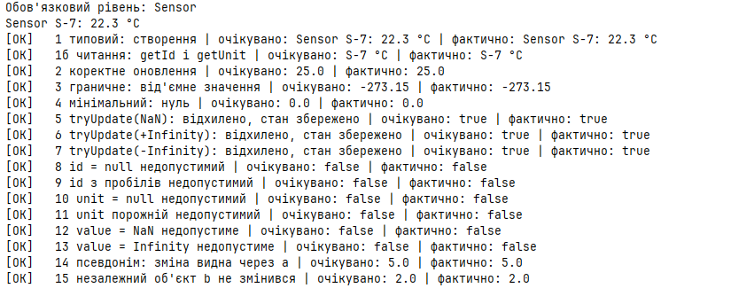
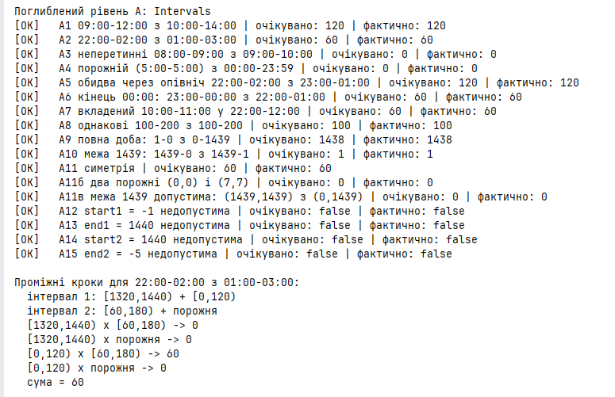
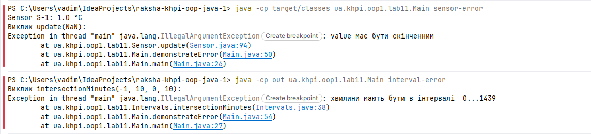

# Звіт з лабораторної роботи № 11

- **Тема:** Простий інкапсульований предметний клас
- **Дисципліна:** Об'єктно-орієнтоване програмування (Java). Частина 1
- **Студент:** Ракша Вадим, КН-925А. Варіант 1 (непарний), поглиблений рівень — завдання A
- **Pull Request:** [https://github.com/Nevalik/raksha-khpi-oop-java-1/pull/12](https://github.com/Nevalik/raksha-khpi-oop-java-1/pull/12)

## Налаштування середовища

| Компонент | Версія |
|---|---|
| ОС | Windows 11 |
| JDK | 21 (`java -version`: "21.0.12" 2026-07-21 LTS) |
| Maven | Apache Maven 3.10.0 (`mvn -v`) |
| Git | 2.53.0.windows.1 (`git --version`) |
| IDE | IntelliJ IDEA 2026.2.3 |

Складання та запуск:

```bash
mvn clean package
java -cp target/classes ua.khpi.oop1.lab11.Main
```

## Мета

Спроєктувати простий предметний клас, який створює лише коректні об'єкти, захищає власний стан і надає операції, названі за змістом предметної області.

## Обов'язковий рівень — варіант 1

**Умова:** клас датчика з ідентифікатором, одиницею та поточним скінченним показом.

## Поглиблений рівень — A: перетин двох добових інтервалів

### 1. Вхід, результат, обмеження

- **Вхід:** чотири цілих `start1, end1, start2, end2` — хвилини доби.
- **Результат:** `int` — сумарна кількість хвилин перетину.
- **Обмеження:** кожна межа в діапазоні `0..1439`.
- **Семантика:** інтервал `[start, end)` — межа початку включається, межа завершення не включається; `end < start` — перехід через опівніч; `start == end` — порожній інтервал.
- **Некоректні дані:** межа поза `0..1439` → `IllegalArgumentException`. Допустимість межі перевіряє `isValidMinute`.

### 2. Алгоритм (псевдокод)

```
intersectionMinutes(s1, e1, s2, e2):
    якщо будь-яка межа поза 0..1439: виняток IllegalArgumentException
    first1  = firstPartEnd(s1, e1)     // перша частина  [s1, first1)
    second1 = secondPartEnd(s1, e1)    // друга частина  [0,  second1)
    first2  = firstPartEnd(s2, e2)
    second2 = secondPartEnd(s2, e2)
    повернути overlap(s1, first1, s2, first2)
            + overlap(s1, first1, 0,  second2)
            + overlap(0,  second1, s2, first2)
            + overlap(0,  second1, 0,  second2)

firstPartEnd(s, e):
    якщо s < e: повернути e        // без переходу через опівніч
    якщо s > e: повернути 1440     // перехід: перша частина до кінця доби
    інакше:     повернути s        // s == e: частина порожня

secondPartEnd(s, e):
    якщо s > e: повернути e        // перехід: друга частина [0, e)
    інакше:     повернути 0        // другої частини немає (порожня)

overlap(from1, to1, from2, to2):
    from = більше з (from1, from2)
    to   = менше з (to1, to2)
    якщо to > from: повернути to - from
    інакше:         повернути 0
```

**Ключова ідея:** інтервал, що переходить через опівніч, розбивається на дві частини: `[start, 1440)` і `[0, end)`. Кожна частина є звичайним інтервалом на прямій, а перетин двох звичайних інтервалів дорівнює `to − from`, якщо `to > from`, інакше 0. Порожня частина має кінець не більший за початок, тому її перетин завжди 0. Сума чотирьох попарних перетинів частин є відповіддю; частини одного інтервалу не перетинаються між собою, тому подвійного підрахунку немає. Кожну частину задано двома числами, тому масиви не потрібні.

### 3. Реалізація

Код: [`Intervals.java`](../../src/main/java/ua/khpi/oop1/lab11/Intervals.java), метод `intersectionMinutes`; допоміжні методи `firstPartEnd`, `secondPartEnd` і `overlap`. Алгоритм описано в п. 2 вище. Проміжні кроки виводить `Main.printTrace`, сам клас у консоль не пише.

Таблицю очікуваних і фактичних результатів, власний граничний набір і проміжні кроки наведено в розділі «Тестування і визначення набору даних».

## Аналіз задачі

Датчик — це об'єкт вимірювання, який має незмінні ідентифікатор і одиницю вимірювання та змінний поточний показ.

**Інваріант класу `Sensor`:**

1. `id` не `null` і не порожній (після `isBlank()`);
2. `unit` не `null` і не порожній;
3. `value` скінченне: не `NaN` і не `±Infinity`.

**Реакція на недопустимий виклик:** `IllegalArgumentException`; перевірка виконується **до** присвоєння, тому попередній стан об'єкта зберігається. Умови допустимості винесено в статичні `isValidText` і `isValidValue`, їх використовують і конструктор, і `update`, і демонстраційний клас. Для перевірки без винятку є `tryUpdate`: повертає `false` і залишає показ без змін.

## Структура класів

### Клас `Sensor`

| Поле | Тип | Зміст | Одиниця | Правило допустимості |
|------|-----|-------|---------|----------------------|
| `id` | `String` (`private final`) | Ідентифікатор датчика | — | не `null`, не порожній |
| `unit` | `String` (`private final`) | Одиниця вимірювання (наприклад, `°C`, `V`) | — | не `null`, не порожня |
| `value` | `double` (`private`) | Поточний показ | задається `unit` | скінченне число |

| Метод | Призначення |
|-------|-------------|
| `Sensor(String id, String unit, double value)` | Конструктор, установлює інваріант |
| `String getId()` | Повертає ідентифікатор |
| `String getUnit()` | Повертає одиницю вимірювання |
| `double getValue()` | Повертає поточний показ |
| `void update(double newValue)` | Змістовна зміна стану: оновлення показу; недопустиме значення → `IllegalArgumentException` |
| `boolean tryUpdate(double newValue)` | Те саме без винятку: `false` і стан не змінюється, якщо значення недопустиме |
| `static boolean isValidText(String)` | Умова для `id` і `unit`: не `null`, не порожній |
| `static boolean isValidValue(double)` | Умова для показу: скінченне число |
| `String toString()` | Текстове подання `Sensor <id>: <value> <unit>` |

Ідентифікатор подано рядком (`String`), бо реальні ідентифікатори датчиків часто містять літери (`S-7`); умова вимагає лише наявності ідентифікатора.

Окремого `setValue`/`setId` немає: `id` і `unit` незмінні (`final`), а показ змінюється лише операцією `update`, яка зберігає інваріант.

### Відповідність інваріанта перевіркам

| Частина інваріанта | Конструктор | `update` / `tryUpdate` |
|--------------------|:-----------:|:----------------------:|
| `id` непорожній | ✔ | — (`final`) |
| `unit` непорожня | ✔ | — (`final`) |
| `value` скінченне | ✔ | ✔ |

### Клас `Intervals` (поглиблений рівень)

| Метод | Призначення |
|-------|-------------|
| `static boolean isValidMinute(int)` | Межа допустима: `0..1439` |
| `static int intersectionMinutes(int, int, int, int)` | Кількість хвилин перетину двох інтервалів; недопустима межа → `IllegalArgumentException` |
| `static int firstPartEnd(int, int)` | Кінець першої частини `[start, ...)` інтервалу |
| `static int secondPartEnd(int, int)` | Кінець другої частини `[0, ...)` (для переходу через опівніч) |
| `static int overlap(int, int, int, int)` | Довжина перетину двох звичайних півінтервалів |

Клас має приватний конструктор: він містить лише статичні методи.

## Алгоритми та опис програми

- `Sensor` — предметний клас ([`Sensor.java`](../../src/main/java/ua/khpi/oop1/lab11/Sensor.java)).
- `Intervals` — розв'язання завдання A ([`Intervals.java`](../../src/main/java/ua/khpi/oop1/lab11/Intervals.java)).
- `Main` — демонстраційний клас: створює об'єкти, виконує контрольні сценарії, виводить `[OK]/[FAIL]` і підсумок. Запуск з аргументом `sensor-error` або `interval-error` показує реакцію на недопустимий виклик: виняток `IllegalArgumentException` ([`Main.java`](../../src/main/java/ua/khpi/oop1/lab11/Main.java)).
- Обчислення (`Sensor`, `Intervals`) відокремлені від консольного виведення: уся робота з `System.out`, включно з показом проміжних кроків алгоритму, зосереджена в `Main`.

## Тестування і визначення набору даних

### Протокол перевірки: обов'язковий рівень (`Sensor`)

| № | Вхід | Очікувано | Фактично | Статус |
|---|------|-----------|----------|:------:|
| 1 | Типовий: `("S-7","°C",24.5)` | `Sensor S-7: 24.5 °C` | `Sensor S-7: 24.5 °C` | OK |
| 1б | Читання: `getId()`, `getUnit()` | `S-7 °C` | `S-7 °C` | OK |
| 2 | `update(25.0)` | `25.0` | `25.0` | OK |
| 3 | Граничний: `update(-273.15)` | `-273.15` | `-273.15` | OK |
| 4 | Мінімальний: `update(0.0)` | `0.0` | `0.0` | OK |
| 5 | `tryUpdate(NaN)` | `false`, стан збережено | `false`, стан збережено | OK |
| 6 | `tryUpdate(+Infinity)` | `false`, стан збережено | `false`, стан збережено | OK |
| 7 | `tryUpdate(-Infinity)` | `false`, стан збережено | `false`, стан збережено | OK |
| 8 | `isValidText(null)` для `id` | `false` (конструктор кидає виняток) | `false` | OK |
| 9 | `isValidText("  ")` для `id` | `false` (конструктор кидає виняток) | `false` | OK |
| 10 | `isValidText(null)` для `unit` | `false` (конструктор кидає виняток) | `false` | OK |
| 11 | `isValidText("")` для `unit` | `false` (конструктор кидає виняток) | `false` | OK |
| 12 | `isValidValue(NaN)` | `false` (конструктор кидає виняток) | `false` | OK |
| 13 | `isValidValue(+Infinity)` | `false` (конструктор кидає виняток) | `false` | OK |
| 14 | Псевдонім: `alias = a; alias.update(5.0)` | `a.getValue() == 5.0` | `5.0` | OK |
| 15 | Незалежний об'єкт `b` | `2.0` (не змінився) | `2.0` | OK |



### Протокол перевірки: поглиблений рівень A (`Intervals`)

| № | Дані | Очікувано | Фактично | Статус |
|---|------|-----------|----------|:------:|
| A1 | 09:00–12:00 з 10:00–14:00 (540,720,600,840) | 120 | 120 | OK |
| A2 | 22:00–02:00 з 01:00–03:00 (1320,120,60,180) | 60 | 60 | OK |
| A3 | неперетинні 08:00–09:00 з 09:00–10:00 | 0 | 0 | OK |
| A4 | порожній (300,300) з (0,1439) | 0 | 0 | OK |
| A5 | обидва через опівніч 22:00–02:00 з 23:00–01:00 | 120 | 120 | OK |
| A6 | кінець 00:00: 23:00–00:00 з 22:00–01:00 | 60 | 60 | OK |
| A7 | вкладений 10:00–11:00 у 22:00–12:00 | 60 | 60 | OK |
| A8 | однакові (100,200) і (100,200) | 100 | 100 | OK |
| A9 | (1,0) з (0,1439) | 1438 | 1438 | OK |
| A10 | межа 1439: (1439,0) з (1439,1) | 1 | 1 | OK |
| A11 | симетрія: (60,180) з (1320,120) | 60 | 60 | OK |
| A11б | два порожні: (0,0) і (7,7) | 0 | 0 | OK |
| A11в | межа 1439 допустима: (1439,1439) з (0,1439) | 0 | 0 | OK |
| A12 | `start1 = -1`: `isValidMinute` | `false` (метод кидає виняток) | `false` | OK |
| A13 | `end1 = 1440`: `isValidMinute` | `false` (метод кидає виняток) | `false` | OK |
| A14 | `start2 = 1440`: `isValidMinute` | `false` (метод кидає виняток) | `false` | OK |
| A15 | `end2 = -5`: `isValidMinute` | `false` (метод кидає виняток) | `false` | OK |



**Власний граничний набір:** A5 (два інтервали через опівніч → 120), A6 (кінець рівно на 00:00), A9 і A10 (межі 0 та 1439), A8 (повний збіг).

**Проміжні кроки для нетривіального набору** (22:00–02:00 з 01:00–03:00):

```
інтервал 1: [1320,1440) + [0,120)
інтервал 2: [60,180) + порожня
[1320,1440) x [60,180) -> 0
[1320,1440) x порожня -> 0
[0,120) x [60,180) -> 60
[0,120) x порожня -> 0
сума = 60
```

Результат: 60 хвилин (01:00–02:00).

### Реакція на недопустимий виклик

Самі винятки показує запуск з аргументом (виняток не перехоплюється, програма завершується з повідомленням):

```bash
java -cp target/classes ua.khpi.oop1.lab11.Main sensor-error
java -cp target/classes ua.khpi.oop1.lab11.Main interval-error
```




## Висновки

1. Клас `Sensor` створює лише коректні об'єкти: інваріант (непорожні `id` і `unit`, скінченний `value`) установлюється в конструкторі й зберігається методами `update` і `tryUpdate`.
2. Поля приватні, `id` та `unit` незмінні; стан змінюється лише змістовною операцією `update`, яка перевіряє аргумент до присвоєння, тому недопустимий виклик залишає попередній стан.
3. Завдання A розв'язано розбиттям кожного інтервалу на дві частини (до 1440 і від 0) та сумою чотирьох попарних перетинів; усі 16 + 17 перевірок пройдено (`Passed: 33, failed: 0`).