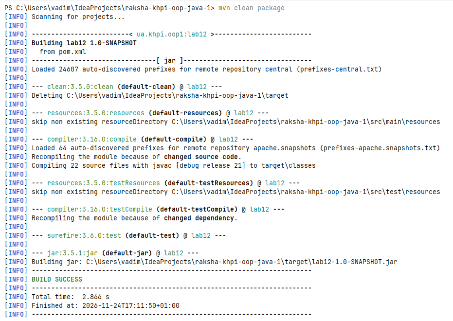
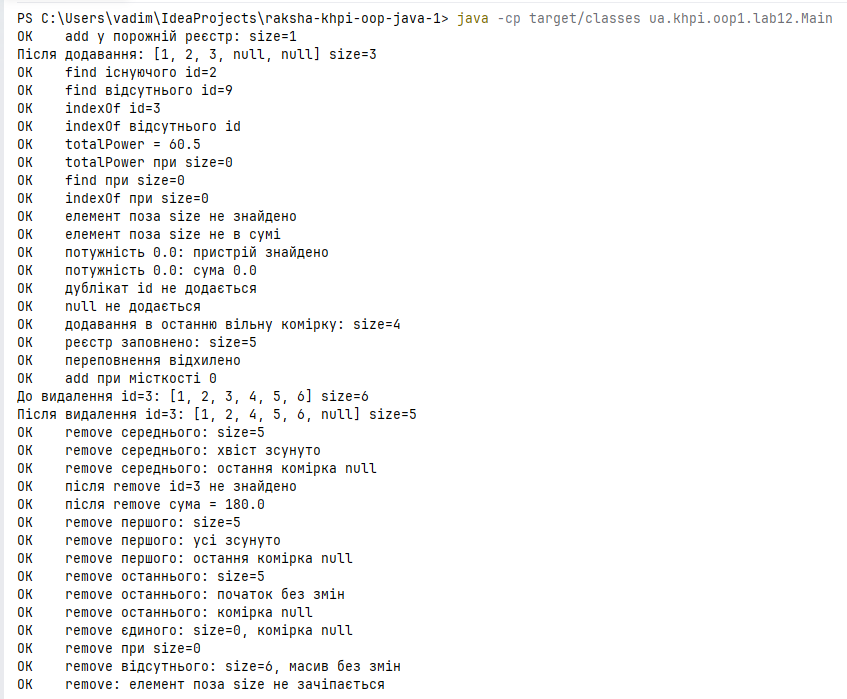
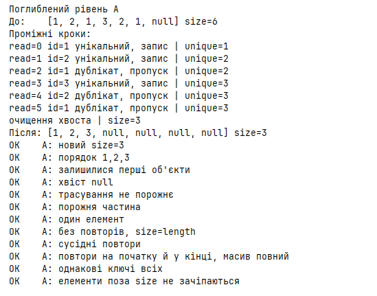
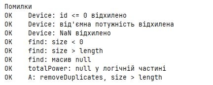

# Звіт з лабораторної роботи № 12

- **Тема:** Масив предметних об'єктів і базові операції над ним
- **Дисципліна:** Об'єктно-орієнтоване програмування (Java). Частина 1
- **Студент:** Ракша Вадим, КН-925А. № 17 (1), поглиблений рівень — завдання A
- **Pull Request:** [https://github.com/Nevalik/raksha-khpi-oop-java-1/pull/13](https://github.com/Nevalik/raksha-khpi-oop-java-1/pull/13)

## Налаштування середовища

| Компонент | Версія |
|---|---|
| ОС | Windows 11 |
| JDK | 21 (`java -version`: "21.0.12" 2026-07-21 LTS) |
| Maven | Apache Maven 3.10.0 (`mvn -v`) |
| Git | 2.53.0.windows.1 (`git --version`) |
| IDE | IntelliJ IDEA 2026.2.3 |

Складання та запуск:

```bash
mvn clean package
java -cp target/classes ua.khpi.oop1.lab12.Main
```


Каталоги `out/` і `target/` додано до `.gitignore`.

## Мета

Реалізувати фіксоване сховище предметних об'єктів на звичайному масиві з окремими поняттями фізичної місткості та логічного розміру й базовими операціями: додавання, пошук, агрегування, видалення зі зсувом.

## Обов'язковий рівень — варіант 1

**Умова:** реєстр пристроїв із пошуком за ідентифікатором і сумою потужностей.

**Реалізовано:** `indexOf`, `find`, `totalPower`, `add`, `removeId` (клас `ObjectArrayService`) над предметним класом `Device`. Контракт, межі й граничні стани описано в розділі «Аналіз задачі», структуру класів — у розділі «Структура класів», результати перевірок — у розділі «Тестування і визначення набору даних».

## Поглиблений рівень — A: стабільне вилучення дублікатів

### 1. Вхід, результат, обмеження

- **Вхід:** масив `Device[] data` і логічний розмір `size`, `0 ≤ size ≤ data.length`. Елементи `data[0..size)` не дорівнюють `null` (щільний префікс).
- **Результат:** новий логічний розмір. У `data[0..новий size)` лишається перший об'єкт із кожним ідентифікатором у початковому порядку; комірки від нового розміру до старого `size` заповнені `null`.
- **Обмеження:** операція виконується в тому самому масиві за допомогою індексів і циклів; збіг шукається лише в уже сформованій унікальній частині. Значення інших полів (`power`) у визначенні дубліката не беруть участі.
- **Некоректні дані:** `data == null`, `size < 0`, `size > data.length` або `null` у логічній частині `data[0..size)` → `IllegalArgumentException`.

### 2. Алгоритм (псевдокод)

```
removeDuplicates(data, size):
    перевірити data, size і відсутність null у data[0..size) (інакше IllegalArgumentException)
    unique = 0                              // data[0..unique) — унікальна частина
    для read від 0 до size - 1:
        candidate = data[read]
        duplicate = false
        для index від 0 до unique - 1:
            якщо data[index].id == candidate.id:
                duplicate = true; перервати
        якщо не duplicate:
            data[unique] = candidate
            unique = unique + 1
    для index від unique до size - 1:
        data[index] = null                  // очищення вільного хвоста
    повернути unique
```

**Ключова ідея:** змінна `unique` одночасно є кількістю вже відібраних об'єктів і позицією наступного запису. Індекс читання `read` завжди не менший за `unique`, тому запис `data[unique] = candidate` не затирає ще не прочитані елементи. Порядок зберігається, бо читання йде зліва направо, а запис лише в кінець унікальної частини. Перший об'єкт кожного ідентифікатора залишається, бо пізніші копії знаходять його в унікальній частині й пропускаються. Додаткового масиву не потрібно.

### 3. Реалізація

Код: [`ObjectArrayService.java`](../../src/main/java/ua/khpi/oop1/lab12/ObjectArrayService.java), методи `removeDuplicates` і `removeDuplicatesTraced`. Перший викликає другий без трасування; другий, якщо йому передано `StringBuilder`, дописує до нього текст проміжних кроків. Сервіс у консоль не пише: текст виводить `Main`.

Таблицю очікуваних і фактичних результатів, власний граничний набір і проміжні кроки наведено в розділі «Тестування і визначення набору даних».

## Аналіз задачі

Реєстр — це масив `Device[]` фіксованої місткості (`data.length`) і окрема змінна `size` — логічний розмір. Дійсні посилання лежать у щільному префіксі `[0, size)`, решта комірок дорівнює `null`. Усі проходи обмежені `size`, тому комірки за межею префікса не переглядаються.

**Інваріант сховища:** `0 ≤ size ≤ data.length`; комірки до `size` не містять `null`.

**Інваріант класу `Device`:** `id > 0`; `power` — скінченне число не менше нуля. Недопустимі дані → `IllegalArgumentException` у конструкторі.

**Результати за відсутності даних і особливих станів:**

| Ситуація | Результат |
|----------|-----------|
| Пошук відсутнього `id` | `find` → `null`, `indexOf` → `-1` |
| Сума потужностей порожньої частини (`size = 0`) | `0.0` |
| `add` з `null`, повторним `id` або в повний реєстр | розмір не змінюється |
| Видалення відсутнього `id` | розмір і масив не змінюються |
| `data == null`, `size < 0`, `size > data.length` або `null` у `data[0..size)` | `IllegalArgumentException` |

## Структура класів

### Клас `Device`

| Поле | Тип | Зміст | Одиниця | Правило допустимості |
|------|-----|-------|---------|----------------------|
| `id` | `int` (`private final`) | Ідентифікатор пристрою | — | більше нуля |
| `power` | `double` (`private final`) | Потужність пристрою | Вт | скінченне, не менше нуля |

| Метод | Призначення |
|-------|-------------|
| `Device(int id, double power)` | Конструктор, установлює інваріант |
| `int id()` | Повертає ідентифікатор |
| `double power()` | Повертає потужність у ватах |

Об'єкт незмінний: полів-змінювачів немає.

### Клас `ObjectArrayService`

| Метод | Призначення |
|-------|-------------|
| `static int indexOf(Device[], int, int)` | Індекс першого пристрою з заданим `id` або `-1` |
| `static Device find(Device[], int, int)` | Пристрій за `id` або `null` |
| `static double totalPower(Device[], int)` | Сума потужностей логічної частини |
| `static int add(Device[], int, Device)` | Додає в кінець префікса, повертає новий `size` |
| `static int removeId(Device[], int, int)` | Видаляє пристрій за `id` зі зсувом хвоста, повертає новий `size` |
| `static int removeDuplicates(Device[], int)` | Завдання A: стабільне вилучення дублікатів, повертає новий `size` |
| `static int removeDuplicatesTraced(Device[], int, StringBuilder)` | Те саме із записом проміжних кроків |
| `private static void checkRange(Device[], int)` | Перевірка масиву, логічного розміру й відсутності `null` у `data[0..size)` |

Клас має приватний конструктор: він містить лише статичні методи й не зберігає прихованого стану, усі дані передаються через параметри.

### Клас `Main`

Демонстраційний клас: створює об'єкти, виконує контрольні сценарії, виводить `OK`/`FAIL` і підсумок. Містить допоміжні методи `sixDevices` (готовий реєстр із шести пристроїв), `ids` (текстове подання ідентифікаторів масиву) і `check` (облік результатів).

## Алгоритми та опис програми

- `Device` — предметний клас ([`Device.java`](../../src/main/java/ua/khpi/oop1/lab12/Device.java)).
- `ObjectArrayService` — операції над масивом і розв'язання завдання A ([`ObjectArrayService.java`](../../src/main/java/ua/khpi/oop1/lab12/ObjectArrayService.java)).
- `Main` — перевірки та консольний вивід ([`Main.java`](../../src/main/java/ua/khpi/oop1/lab12/Main.java)).

Опис операцій:

- **`indexOf`** — лінійний прохід по `[0, size)`, повертає перший збіг або `-1`. **`find`** викликає `indexOf` і повертає об'єкт або `null`.
- **`totalPower`** — накопичує суму `power()` по `[0, size)`; для `size = 0` результат `0.0`.
- **`add`** — відхиляє `null`, повний масив (`size == data.length`) і повторний `id`; інакше записує об'єкт у `data[size]` і повертає `size + 1`. Відхилення повертає попередній `size`.
- **`removeId`** — знаходить індекс за `id`, зсуває наступні посилання на одну позицію ліворуч, очищає `data[size - 1]` значенням `null`, повертає `size - 1`.
- **`removeDuplicates`** — див. розділ про поглиблений рівень.

Обчислення (`ObjectArrayService`) відокремлені від консольного виведення: уся робота з `System.out`, включно з показом проміжних кроків, зосереджена в `Main`. Сервіс лише повертає текст через `StringBuilder`.

Відхилення недопустимих даних перевіряється в `Main` блоками `try/catch`: перехоплений `IllegalArgumentException` означає, що перевірку пройдено (див. таблицю E1–E8).

## Тестування і визначення набору даних

Усі перевірки виконує `Main`. Результат запуску: `Пройдено: 54, помилок: 0` (46 перевірок обов'язкового рівня й завдання A + 8 перевірок недопустимих даних = 54).

### Протокол перевірки: обов'язковий рівень (варіант 1)

Вхідний реєстр: місткість 5, пристрої 1 (12.5 Вт), 2 (18.0 Вт), 3 (30.0 Вт), `size = 3`.

| № | Вхід | Очікувано | Фактично | Статус |
|---|------|-----------|----------|:------:|
| 1 | Мінімальний: `add` пристрою 1 у порожній реєстр | `size = 1` | `size = 1` | OK |
| 2 | Типовий: `find` `id = 2` | `power = 18.0` | `18.0` | OK |
| 3 | Типовий: `find` `id = 9` (немає) | `null` | `null` | OK |
| 4 | Типовий: `indexOf` `id = 3` | `2` | `2` | OK |
| 5 | Типовий: `indexOf` `id = 9` (немає) | `-1` | `-1` | OK |
| 6 | Типовий: `totalPower` трьох пристроїв | `60.5` | `60.5` | OK |
| 7 | Мінімальний: `totalPower` при `size = 0` | `0.0` | `0.0` | OK |
| 8 | Мінімальний: `find` при `size = 0` | `null` | `null` | OK |
| 9 | Мінімальний: `indexOf` при `size = 0` | `-1` | `-1` | OK |
| 10 | Граничний: пристрій `id = 7` у комірці `data[size]` | не знайдено | `null` | OK |
| 11 | Граничний: сума при пристрої в `data[size]` | `60.5` (не враховано) | `60.5` | OK |
| 12 | Граничний: пристрій з `power = 0.0` | знайдено | знайдено | OK |
| 13 | Граничний: сума одного пристрою з `power = 0.0` | `0.0` | `0.0` | OK |
| 14 | Помилка: `add` дубліката `id = 2` | `size` не змінився, `data[size] == null` | `size = 3` | OK |
| 15 | Помилка: `add(null)` | `size` не змінився | `size = 3` | OK |
| 16 | Граничний: `add` пристрою 4 | `size = 4` | `size = 4` | OK |
| 17 | Граничний: `add` в останню вільну комірку | `size = 5`, `data[4].id() == 5` | `size = 5` | OK |
| 18 | Помилка: `add` у повний реєстр | `size = 5` | `size = 5` | OK |
| 19 | Мінімальний: `add` при місткості 0 | `0` | `0` | OK |
| 20 | Типовий: видалення середнього (`id = 3`) із реєстру `[1..6]`, `size = 6` | `size = 5` | `size = 5` | OK |
| 21 | Типовий: хвіст зсунуто | у префіксі `id` 1, 2, 4, 5, 6 | 1, 2, 4, 5, 6 | OK |
| 22 | Типовий: остання колишня комірка | `null` | `null` | OK |
| 23 | Типовий: пошук видаленого `id = 3` | `null` | `null` | OK |
| 24 | Типовий: сума після видалення (10 + 20 + 40 + 50 + 60 Вт) | `180.0` | `180.0` | OK |
| 25 | Граничний: видалення першого (`id = 1`) | `size = 5` | `size = 5` | OK |
| 26 | Граничний: зсув на всю довжину | у префіксі `id` 2, 3, 4, 5, 6 | 2, 3, 4, 5, 6 | OK |
| 27 | Граничний: остання колишня комірка після видалення першого | `null` | `null` | OK |
| 28 | Граничний: видалення останнього (`id = 6`) | `size = 5` | `size = 5` | OK |
| 29 | Граничний: початок без змін | у префіксі `id` 1, 2, 3, 4, 5 | 1, 2, 3, 4, 5 | OK |
| 30 | Граничний: комірка видаленого останнього | `null` | `null` | OK |
| 31 | Мінімальний: видалення єдиного елемента | `size = 0`, комірка `null` | `size = 0`, `null` | OK |
| 32 | Мінімальний: видалення при `size = 0` | `0` | `0` | OK |
| 33 | Помилка: видалення відсутнього `id = 99` | `size = 6`, масив без змін | `size = 6` | OK |
| 34 | Граничний: пристрій `id = 6` лежить у `data[5]` поза `size = 5` | `size = 5`, комірка не зачеплена | `size = 5` | OK |





Фактичний вивід програми для реєстру (фрагмент, рядки з `OK` між ними пропущено):

```
Після додавання: [1, 2, 3, null, null] size=3
До видалення id=3: [1, 2, 3, 4, 5, 6] size=6
Після видалення id=3: [1, 2, 4, 5, 6, null] size=5
```

### Протокол перевірки: поглиблений рівень A

| № | Дані | Очікувано | Фактично | Статус |
|---|------|-----------|----------|:------:|
| A1 | Типовий: `[1, 2, 1, 3, 2, 1, null]`, `size = 6` — новий розмір | `3` | `3` | OK |
| A2 | Той самий набір — порядок | `id` 1, 2, 3 | 1, 2, 3 | OK |
| A3 | Той самий набір — залишено перші об'єкти (`power` 1.0, 2.0, 3.0) | перші екземпляри | перші екземпляри | OK |
| A4 | Той самий набір — хвіст | `null` в комірках 3–6 | `null` | OK |
| A5 | Той самий набір — трасування | не порожнє | не порожнє | OK |
| A6 | Мінімальний: порожня частина (`size = 0`) | `0` | `0` | OK |
| A7 | Мінімальний: один елемент | `1`, об'єкт на місці | `1` | OK |
| A8 | Без повторів `[4, 5, 6]`, `size = data.length` | `3`, порядок 4, 5, 6 | `3`, 4, 5, 6 | OK |
| A9 | Сусідні повтори `[8, 8, 9]` | `2`, `id` 8 і 9, `power` першого 1.0, хвіст `null` | збігається | OK |
| A10 | Повтори на початку й у кінці повного масиву `[1, 1, 2, 3, 3]` | `3`, `id` 1, 2, 3, дві комірки `null` | збігається | OK |
| A11 | Однакові ключі всіх `[5, 5, 5]` | `1`, `power = 1.0`, дві комірки `null` | збігається | OK |
| A12 | Граничний: `[1, 1, 1, 2]`, `size = 2` | `1`, комірки поза `size` не зачеплено | збігається | OK |



**Власний граничний набір:** A10 (повтори на обох краях повного масиву), A11 (однакові ключі всіх об'єктів), A12 (елементи за межею логічного розміру не змінюються), A7 (один елемент).

**Проміжні кроки для нетривіального набору** `[1, 2, 1, 3, 2, 1, null]`, `size = 6` (фактичний вивід програми):


```
До:    [1, 2, 1, 3, 2, 1, null] size=6
Проміжні кроки:
read=0 id=1 унікальний, запис | unique=1
read=1 id=2 унікальний, запис | unique=2
read=2 id=1 дублікат, пропуск | unique=2
read=3 id=3 унікальний, запис | unique=3
read=4 id=2 дублікат, пропуск | unique=3
read=5 id=1 дублікат, пропуск | unique=3
очищення хвоста | size=3
Після: [1, 2, 3, null, null, null, null] size=3
```

Під час проходу на кроці `read=3` значення `3` записується в комірку `unique = 2` поверх уже прочитаного дубліката `id = 1` (індекс 2); перша копія `id = 1` в індексі 0 не змінюється. Записи не затирають непрочитані елементи, бо `unique ≤ read`.


### Протокол перевірки: недопустимі дані

| № | Вхід | Очікувано | Фактично | Статус |
|---|------|-----------|----------|:------:|
| E1 | Помилка: `new Device(0, 1.0)` | `IllegalArgumentException` | `IllegalArgumentException` | OK |
| E2 | Помилка: `new Device(1, -5.0)` | `IllegalArgumentException` | `IllegalArgumentException` | OK |
| E3 | Помилка: `new Device(1, Double.NaN)` | `IllegalArgumentException` | `IllegalArgumentException` | OK |
| E4 | Помилка: `find(data, -1, 1)` | `IllegalArgumentException` | `IllegalArgumentException` | OK |
| E5 | Помилка: `find(data, data.length + 1, 1)` | `IllegalArgumentException` | `IllegalArgumentException` | OK |
| E6 | Помилка: `find(null, 0, 1)` | `IllegalArgumentException` | `IllegalArgumentException` | OK |
| E7 | Помилка: `totalPower` для `[1, null, 2]`, `size = 3` | `IllegalArgumentException` | `IllegalArgumentException` | OK |
| E8 | Помилка: `removeDuplicates(data, data.length + 1)` | `IllegalArgumentException` | `IllegalArgumentException` | OK |




Підсумок запуску:

```
Пройдено: 54, помилок: 0
```


## Висновки

1. Реалізовано реєстр пристроїв на звичайному масиві `Device[]` з розділенням місткості (`data.length`) і логічного розміру (`size`). Клас `Device` незмінний, його інваріант (додатний `id`, скінченна невід'ємна потужність) перевіряється в конструкторі. Усі операції сервісу (`indexOf`, `find`, `totalPower`, `add`, `removeId`) працюють лише в префіксі `[0, size)`, комірки після `size` не переглядаються.
2. Відсутні й недопустимі стани мають визначений результат: пошук повертає `-1` або `null`, сума порожньої частини дорівнює `0.0`, `add` відхиляє `null`, повторний `id` і переповнення без зміни `size`, а некоректний `size`, `null`-масив або `null` у логічній частині дають `IllegalArgumentException`. Видалення зсуває хвіст ліворуч і очищає останню комірку значенням `null`, тому щільний префікс зберігається.
3. Завдання A розв'язано стабільним вилученням дублікатів на місці: змінна `unique` є і кількістю відібраних об'єктів, і позицією наступного запису, збіг шукається лише в унікальній частині. Лишається перший об'єкт кожного `id`, порядок зберігається, хвіст заповнюється `null`, повертається новий `size`. Проміжні кроки виводяться через `StringBuilder` для набору `[1, 2, 1, 3, 2, 1]`. Усі перевірки, включно з власним граничним набором, пройдено: `Пройдено: 54, помилок: 0`.